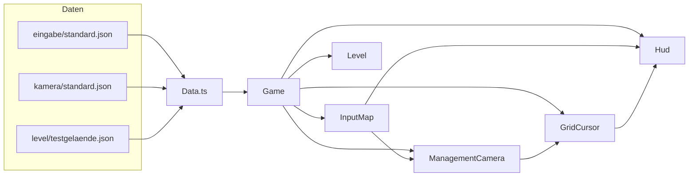

# UrbanEvolution

Wirtschaftssimulation im Browser mit Three.js und TypeScript. Du baust einen eigenen Supermarkt auf und führst ihn, später wächst daraus eine ganze Wertschöpfungskette: Rohstoffe, Produktion, Lager, Verkauf.

Das Spiel wird von **schräg oben** in einer **Management-Ansicht** gespielt, nicht in der Ego-Perspektive.

## Stand

**Meilenstein 1 – Grundgerüst** ✅

- Vite + TypeScript
- Szene mit Himmel, Sonne und Schatten
- Testgelände aus `data/level/testgelaende.json` (Laden, Gehweg, Straße, Lagerhalle als Platzhalter-Quader)
- Management-Kamera: schwenken, drehen, zoomen, bleibt innerhalb des Geländes
- Feld unter der Maus wird markiert und oben angezeigt (Grundlage für Auswählen und Bauen)
- Tastenbelegung aus Daten, umbelegbar; die Hinweise unten lesen die aktuelle Belegung

## Starten

Du brauchst [Node.js](https://nodejs.org) (Version 20 oder neuer).

```bash
npm install      # einmalig: Abhängigkeiten holen
npm run dev      # Entwicklungsserver starten, Adresse steht dann im Terminal
```

Weitere Befehle:

| Befehl | Was passiert |
|---|---|
| `npm run check` | nur Typprüfung |
| `npm run build` | Typprüfung und fertiger Build in `dist/` |
| `npm run preview` | den Build lokal ansehen |

Im Entwicklungsmodus ist das Spiel in der Browser-Konsole als `urbanEvolution` erreichbar, z. B. `urbanEvolution.view.zoom(-2)`.

## Steuerung

| Aktion | Standard |
|---|---|
| Kamera schwenken | `W` `A` `S` `D` oder Pfeiltasten, mittlere Maustaste ziehen |
| Kamera drehen | `Q` / `E`, rechte Maustaste ziehen |
| Zoomen | Mausrad |

Die Belegung steht in `data/eingabe/standard.json`.

## Aufbau

```
data/                 Werte und Inhalte (JSON), werden automatisch eingelesen
  eingabe/            Tastenbelegung (Aktion → Tasten)
  kamera/             Kamerawerte (Neigung, Zoomgrenzen, Geschwindigkeit …)
  level/              Level-Dateien
src/
  main.ts             Einstieg: Spiel erzeugen und starten
  core/Game.ts        Renderer, Szene, Spielschleife – verbindet die Systeme
  core/Data.ts        liest Dateien und ganze Ordner aus data/
  input/InputMap.ts   Aktionen statt fester Tasten, Umbelegen, Tastennamen fürs HUD
  camera/ManagementCamera.ts   Kamera der Management-Ansicht
  world/Level.ts      baut ein Level aus seiner Datei
  world/GridCursor.ts Feld unter dem Mauszeiger
  ui/Hud.ts           HUD-Leisten
  ui/style.css        UI-Kit: Design-Tokens (Slate + Grün)
```



Regeln, die überall gelten:

- **Logik in Code, Werte in Daten.** Zahlen und Inhalte stehen in `data/`, nicht im Code.
- **Kataloge lesen Ordner automatisch** (`readFolder('produkte')`), nichts wird von Hand gepflegt.
- **Neue Features ergänzen, statt Bestehendes umzuschreiben.**

## Nächste Meilensteine

1. ~~Grundgerüst mit Management-Kamera~~
2. Entity-/Komponenten-System und Daten-Registry (Produkte und Bauelemente aus JSON)
3. Interaktion: Objekte unter der Maus erkennen, hervorheben, anklicken; Kontext-Hinweise
4. Stats und HUD (Geld, Level, Zeit) mit Events
5. Einkaufsterminal und Produkte
6. Regal-Slots inklusive Anlegen per Klick (Anker → A → B) und Einräumen
7. Bausystem: Vorschau, Katalog, Bauen, Abreißen, Verschieben
8. Speichern/Laden mit 3 Slots, Haupt- und Pausemenü
9. Kunden-KI: Spawner, Zustände, Wege, Kassen-Warteschlange
10. Danach: Versorgung, erweitertes Bausystem, Fabrik, Lager, Rohstoffe
