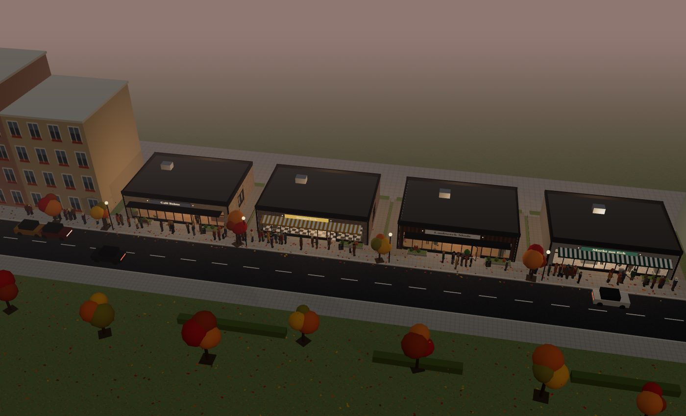
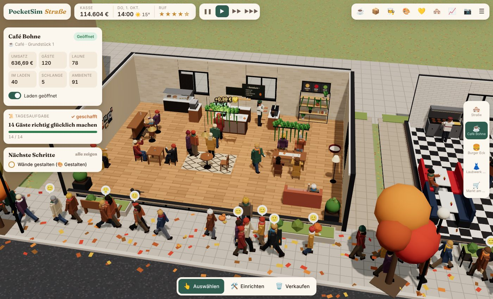
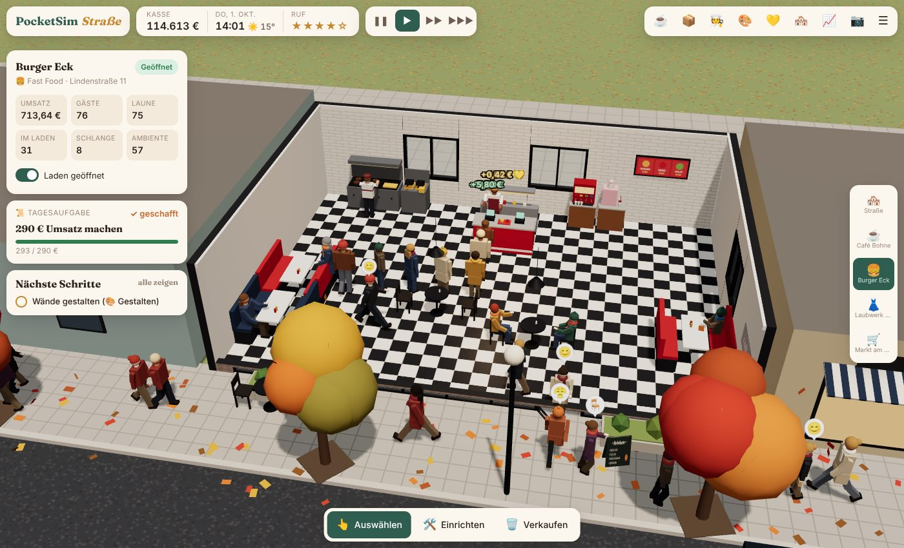
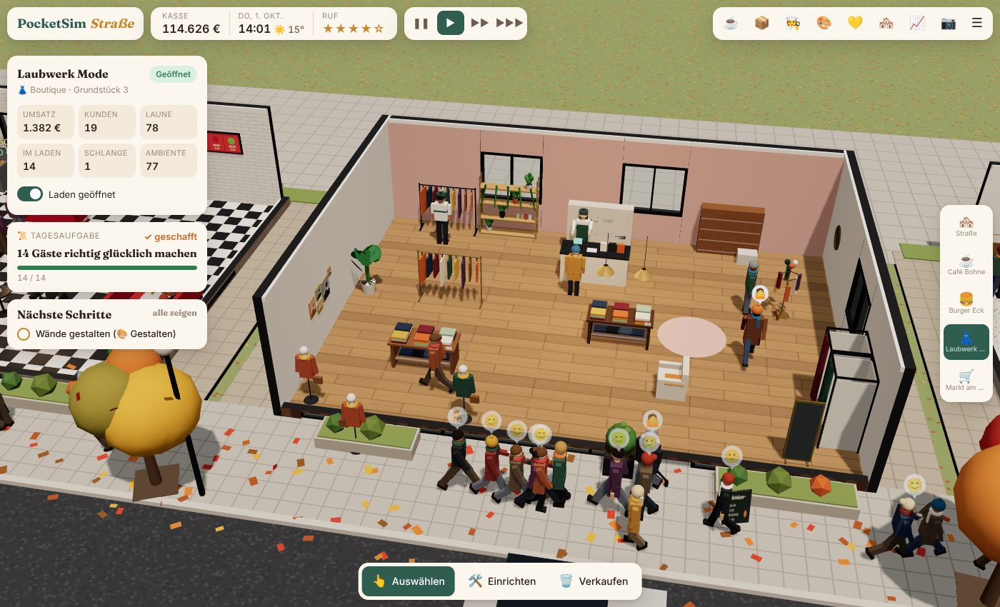
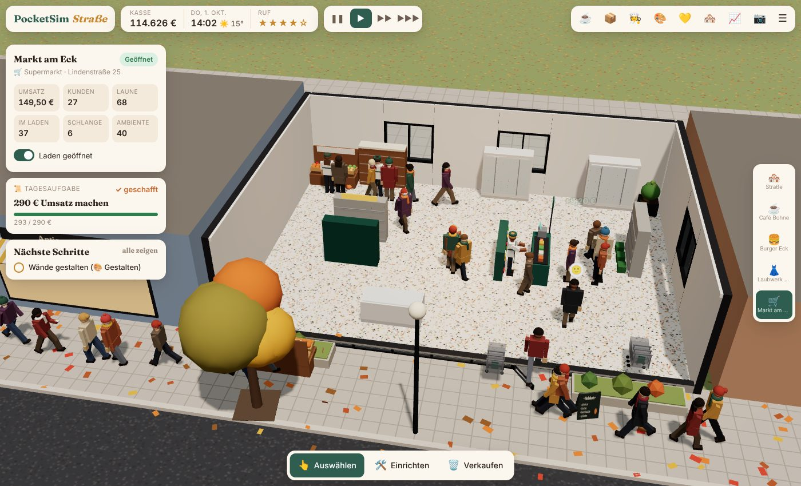
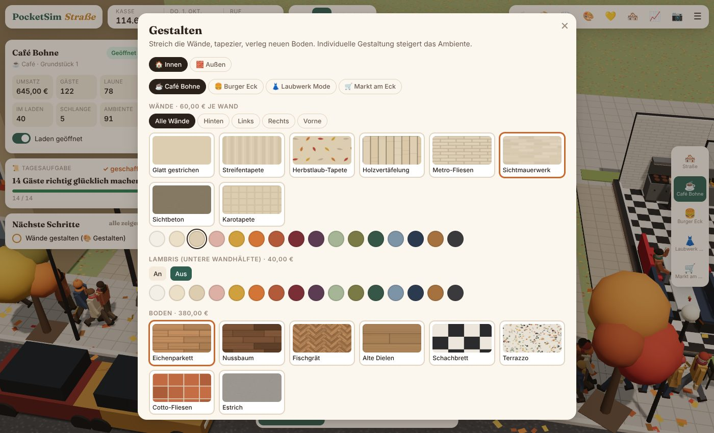

# PocketSim Straße

> Oktober in der Altstadt. Du kaufst Grundstücke an einer herbstlichen Straße und baust darauf deine eigenen Läden: ein gemütliches Café, einen Burgerladen, eine Boutique, einen Supermarkt. Jeder Laden ist ein kleines Schnittmodell, in das du hineinschauen und das du bis ins Detail einrichten kannst.



PocketSim ist eine gemütliche Wirtschaftssimulation im Browser. Die 3D-Grafik läuft mit Three.js. Es gibt keinen Build-Schritt und keinen Login, und das Spiel läuft am Desktop genauso wie auf dem Handy.

## Spielen

ES-Module brauchen einen kleinen Webserver, ein Doppelklick auf `index.html` reicht also nicht:

```bash
python3 -m http.server 8080
# dann http://localhost:8080 öffnen
```

Auf dem iPhone geht das mit Pythonista und `server.py` (inklusive Live-Reload).

| Aktion | Maus / Tastatur | Touch |
|---|---|---|
| Kamera drehen | linke Maustaste ziehen | ein Finger |
| Verschieben / Zoomen | rechte Maustaste / Mausrad | zwei Finger |
| Laden wechseln | Leiste rechts, `Bild ↑` / `Bild ↓`, in der Straßenansicht auf einen Laden klicken | Leiste rechts |
| Möbel platzieren | Klick | antippen (Vorschau), nochmal antippen |
| Möbel drehen | `R` | ⟳-Knopf |
| Pause / Tempo | Leertaste, `1` `2` `3` | Knöpfe oben |
| Fotomodus | `P` | 📷 |

## Die Läden

Zu Beginn wählst du, mit welchem Laden du anfängst. Weitere Grundstücke kaufst du im Fenster **Straße** (🏘️) und eröffnest dort einen beliebigen Laden.

| Laden | So kaufen die Leute ein | Was du brauchst |
|---|---|---|
| ☕ **Café** | an der Theke bestellen, oft hinsetzen | Theke, Siebträger, Vitrine, Tische und Stühle |
| 🍔 **Fast Food** | bestellen, mehrere Sachen pro Bestellung, oft hinsetzen | Bestelltresen, Grill, Fritteuse, Getränke- und Shake-Station, Diner-Sitzecken |
| 👗 **Boutique** | zwischen den Warenträgern stöbern, anprobieren, an der Kasse zahlen | Kassentresen, Kleiderstangen, Präsentiertische, Schuhregal, Accessoire-Stand, Umkleide |
| 🛒 **Supermarkt** | Korb an mehreren Regalen füllen, an der Kasse zahlen | Kasse mit Band, Obststand, Brot-, Kühl-, Getränke-, Süßwaren-, Drogerieregal, Tiefkühltruhe |

| Café | Fast Food |
|---|---|
|  |  |
| **Boutique** | **Supermarkt** |
|  |  |

Die Läden spielen sich unterschiedlich: Das Café lebt von Ambiente und Sitzplätzen, Fast Food von schneller Zubereitung mit mehreren Geräten, die Boutique von wenigen Kund:innen mit großen Bons (eine Umkleide lässt sie öfter kaufen), der Supermarkt von vielen Kund:innen mit vollen Körben und kleinen Margen.

## So läuft ein Tag

- **Öffnungszeiten** 8–19 Uhr. Abends gibt es eine Abrechnung je Laden, mit Wettervorhersage für morgen.
- **Kosten**: Wareneinkauf, Löhne (75 € pro Person und Tag) und laufende Kosten je Grundstück.
- **Personal**: Jede Kasse braucht eine Person. Wer übrig ist, hilft bei der Zubereitung oder beim Einpacken und macht alles schneller.
- **Preise**: Jedes Produkt hat einen fairen Preis. Wer deutlich darüber liegt, verdient pro Verkauf mehr, verliert aber Kundschaft und Laune.
- **Lager**: Frische Ware (Backwaren, Brot, Obst) verdirbt abends. Die Auto-Bestellung kauft nach, kostet aber 10 % Aufschlag.
- **Ruf und Ambiente**: Deko, Vielfalt, Sitzplätze bzw. Warenträger und deine Gestaltung machen einen Laden attraktiv. Zufriedene Kundschaft verbessert den Ruf, der Ruf bringt neue Kundschaft.

## Herbst und Gemütlichkeit

- **Wetter**: Sonne, Wolken, Regen (mit Regenschirmen), Nebel und Herbststurm. Bei Schmuddelwetter zieht es mehr Leute ins Café und zum Imbiss, und sie bleiben länger sitzen. An kalten Tagen sind warme Produkte gefragt.
- **Herbst-Specials** wie Kürbis-Latte, Apfelkuchen, Kürbis-Burger oder Bratapfel-Shake schaltest du einzeln frei.
- **Stammkundschaft**: 16 Nachbar:innen mit Namen und Lieblingsprodukt. Mit jedem schönen Besuch wachsen die Herzen, und mit vielen Herzen gibt es mehr Trinkgeld.
- **Ladenkatzen**: Mit einem Katzenkörbchen zieht eine Katze ein, streunt durch den Laden und besucht die Gäste. Man kann sie streicheln.
- **Tagesaufgaben** mit Belohnung, ein Kalender ab dem 1. Oktober, frühe Dämmerung mit warm leuchtenden Schaufenstern und Schriftzügen.

## Personalisieren



- **Innen** (je Laden): jede Wand einzeln streichen und tapezieren (glatt, Streifen, Herbstlaub, Holz, Metro-Fliesen, Sichtmauerwerk, Sichtbeton, Karo), Lambris an/aus mit Farbe, 8 Böden, Deckenfarbe.
- **Außen** (je Laden): Fassade (Klinker hell/rot/dunkel, Holzlamellen, Sichtbeton, Putz), Stahl- oder Holzvordach oder Markise, Farbe der Schriftzug-Tafel, Fensterrahmen.
- **Möbel**: über 80 Objekte, fast alle in mehreren Farbvarianten. Dazu gehören Trennwände, Glaswände, Holzlamellen, Akustikpaneele, Stahlregale mit Grün, Efeu-Deckenrahmen, Pendel- und Rattanleuchten, Lichterketten, Kamin und Kürbisse. Wandobjekte richten sich automatisch an der nächsten Wand aus, Deckenobjekte hängen über Tischen.
- **Sonstiges**: Ladenname, Schürzenfarbe des Personals, Fotomodus mit Morgen-, Mittags- und Abendlicht.

## Aufbau des Codes

| Datei | Inhalt |
|---|---|
| `src/data.js` | Alle Zahlen: Grundstücke, Ladentypen, Möbel, Produkte, Waren, Farben, Wetter, Aufgaben |
| `src/sim.js` | Die Simulation ohne Grafik: Raster, Bauen, Kundschaft (Theke und Stöbern), Kassen, Wirtschaft, Speichern |
| `src/path.js` | A*-Wegfindung auf dem Ladenraster |
| `src/models.js` | Prozedurale Low-Poly-Modelle, Texturen, Figuren und Katze |
| `src/render.js` | Three.js-Szene: Straße, Läden als Schnittmodelle, Figuren, Wetter, Licht |
| `src/ui.js` | HUD, Baukatalog, Fenster (Karte, Lager, Team, Gestalten, Gäste, Straße, Bilanz) |
| `src/audio.js` | Kleine Klangkulisse (Kasse, Regen, Schnurren) |
| `src/main.js` | Spielschleife, Eingabe, Speichern im Browser |

### Einen neuen Ladentyp ergänzen

1. In `SHOP_TYPES` (`src/data.js`) einen Eintrag anlegen: `mode: 'counter'` (Theke, Sitzen) oder `'browse'` (Regale, Kasse), dazu Andrang, Startlook und Startbestand.
2. Produkte in `PRODUCTS` mit `shop: '<typ>'` und `needs: '<warenträger>'` anlegen, die Waren in `SUPPLIES`.
3. Einrichtung in `FURNITURE` mit `shops: ['<typ>']`: eine Kasse mit `register: true`, Warenträger mit `provides: '<warenträger>'`.
4. In `src/models.js` ein Modell für jedes neue Möbel ergänzen.

Kundschaft, Schlangen, Sitzplätze, Stöbern, Lager, Personal, Gestaltung und Abrechnung funktionieren dann ohne weitere Änderungen.

## Tests

Die Simulation läuft ohne Browser und ist mit Node getestet:

```bash
npm test
```
