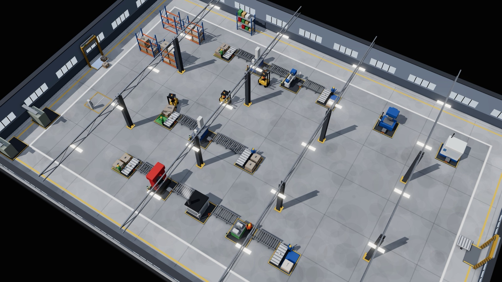
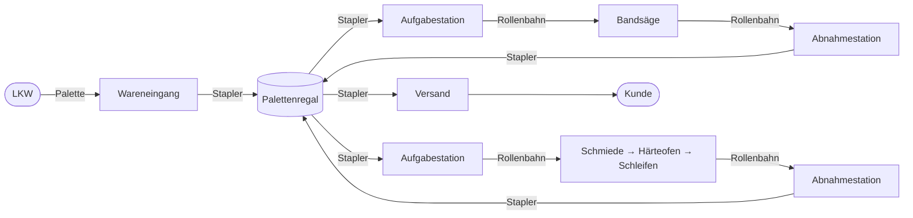
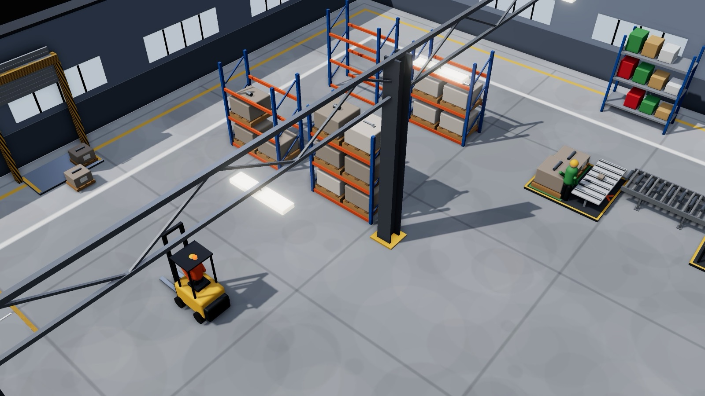
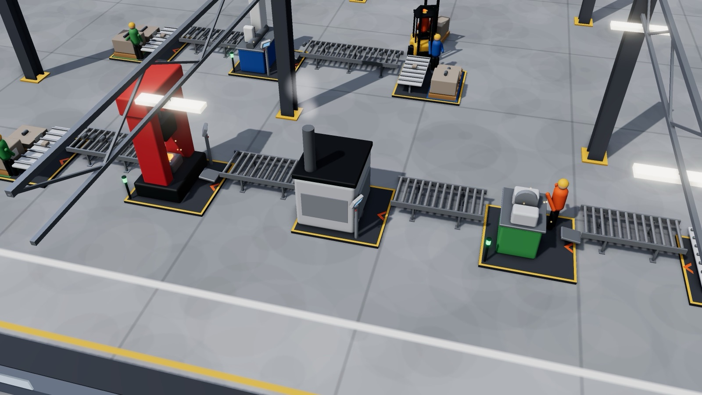
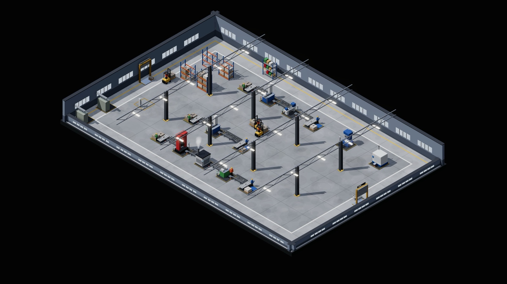
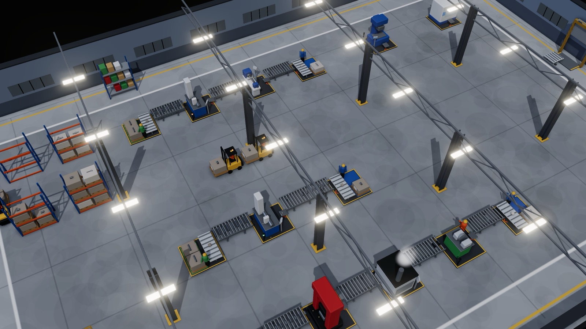

# PocketSim Factory

> Du übernimmst eine leere Fabrikhalle in Remscheid. LKW liefern Paletten mit Rundstahl ans Rolltor, Gabelstapler lagern sie ins Regal ein und bringen sie an die Linien. Über Rollenbahnen geht es durch Säge, Schmiede und Härteofen, und am Ende verlassen Hämmer, Werkzeugkoffer und Akkuschrauber die Halle.



**Live spielen:** [herosrs.github.io/PocketSim](https://herosrs.github.io/PocketSim/)

PocketSim Factory ist ein Fabrik-Aufbauspiel im Browser, inspiriert von **Factorio**, **shapez** und **Satisfactory**. Die 3D-Grafik läuft mit Three.js, in Perspektive oder isometrisch. Es gibt keinen Build-Schritt und keinen Login, und das Spiel läuft auf dem Desktop genauso wie auf dem Handy.

---

## Materialfluss

Teile bewegen sich auf zwei Ebenen: **Paletten** fahren per Gabelstapler durch die Halle, **einzelne Teile** laufen über Rollenbahnen durch die Maschinen. Aufgabe- und Abnahmestationen sind die Übergabepunkte zwischen beiden Ebenen.



| Station | Aufgabe |
|---|---|
| **Wareneingang** | Rolltor an der Außenwand. Bestellt Paletten (à 20 Teile) des gewählten Materials, die per LKW ankommen. |
| **Palettenregal** | 6 Plätze auf 3 Ebenen. Einkaufsware lässt immer einen Platz für Fertigware frei. |
| **Aufgabestation** (Eingangspunkt) | Fordert ein Material an. Der Stapler stellt die Palette hinten ab, ein Werker legt die Teile vorne aufs Band. |
| **Abnahmestation** (Abgabepunkt) | Palettiert Teile vom Band. Volle Paletten (oder Teilpaletten nach 25 s) holt der Stapler ab. |
| **Staplerstation** | Parkplatz und Ladestation, bis zu 3 Stapler je Station. |
| **Versand** | Rolltor an der Außenwand. Verkauft Paletten und auch Teile direkt vom Band. |

**Wer fährt wohin?** Ein Disponent vergibt die Fahraufträge nach Dringlichkeit:
1. Eine Aufgabestation braucht Material → passende Palette aus dem Lager oder direkt vom Wareneingang bzw. von einer Abnahmestation.
2. Volle Paletten an Abnahmestationen → ins Regal.
3. Neue Paletten am Wareneingang → ins Regal.
4. Fertigware im Regal, die keine Aufgabestation anfordert → zum Versand. Einkaufsware wird nie verkauft.

Stapler fahren nur über **freie Hallenfelder**. Rollenbahnen und Maschinen sind für sie Wände, also müssen Gänge frei bleiben. Ist ein Ziel zugebaut, meldet der Inspektor das.





---

## Spielprinzip

1. **Einkaufen**: Am Wareneingang bestellst du Rundstahl, Stahlblech, Holz, Granulat oder Kupferdraht als Paletten.
2. **Lagern und bereitstellen**: Gabelstapler bringen Paletten ins Regal und von dort an die Aufgabestationen.
3. **Fertigen**: Jede Maschine gibt **nur vorne** ab (oranger Pfeil am Boden) und nimmt **hinten und seitlich** an. Das Layout ist damit Teil des Rätsels.
4. **Verkaufen**: Was im Versand ankommt, wird verkauft oder für einen Auftrag gezählt. Viel vom selben Teil drückt den Preis.
5. **Forschen**: Neue Maschinen und Boni kosten Geld und verlangen, dass bestimmte Teile bereits geliefert wurden.

### Die Halle
- 40 × 26 Felder, mit **Hallenstützen** im 8-Meter-Raster, die nicht überbaut werden können.
- **Altbestand** (Meisterbüro, alte Regale, Paletten) steht im Weg und kostet Entsorgung.
- **Signalsäulen** an jeder Maschine: grün läuft, orange blockiert, aus wartet.
- Die Wände zur Kamera hin werden automatisch abgesenkt, damit man in die Halle schaut.



### Produktionsketten (Werkzeugindustrie)

| Stufe | Teile |
|---|---|
| Einkauf | Rundstahl, Stahlblech, Kantholz, Kunststoffgranulat, Kupferdraht |
| Halbzeuge | Stahlrohling, Welle, Holzstiel, Schmiederohling, gehärtetes Teil, Blechteil, Blechgehäuse, Griff, Zahnrad, Spule |
| Produkte | Hammer, Schraubenschlüssel, Zange, Getriebe, Elektromotor |
| Spitzenprodukte | **Werkzeugkoffer**, **Akkuschrauber** |

### Weitere Systeme
- **Strom** über Trafostationen, mit laufenden Kosten. Bei Überlast arbeiten alle Maschinen langsamer.
- **Aufträge** mit Zeitlimit und Bonus, **Ereignisse** wie Baumarkt-Aktion, Stahlpreis oder Energiekrise.
- **Upgrades** für Maschinen und Wareneingang bis Stufe 5.
- **Tag- und Nachtschicht**: Tagsüber fällt Licht durch die Fenster, nachts leuchten die Hallenlampen.
- **Statistik**: Umsatz, Einkauf, Strom, Produktion pro Minute, Marktpreise.
- **Speichern**: automatisch alle 30 s, dazu Export/Import als JSON.



---

## Steuerung

| Eingabe | Aktion |
|---|---|
| Linksklick | Auswählen / Bauen · Ziehen verschiebt die Ansicht |
| Rechte Maustaste ziehen | Ansicht verschieben |
| Mittlere Maustaste ziehen, `Q` / `E` | Kamera drehen (isometrisch in 90°-Schritten) |
| `I` oder Würfel-Button | Isometrische Ansicht ein/aus |
| Mausrad | Zoomen |
| `WASD` / Pfeiltasten | Kamera bewegen |
| `R` | Maschine bzw. Rollenbahn drehen |
| `X` | Abrisswerkzeug |
| `C` | Gebäude unter der Maus kopieren |
| `1`–`9`, `Tab` | Gebäude wählen, Kategorie wechseln |
| `F` / `T` | Forschung / Statistik |
| Leertaste | Pause |
| Touch | Ein Finger baut bzw. verschiebt, zwei Finger bewegen und zoomen |

---

## Eigene 3D-Modelle

Alle Gebäude und Teile haben prozedurale Platzhalter. Eigene Modelle aus Blender legst du als GLB in `models/` ab und trägst sie in `models/manifest.json` ein. Maßstab, Ausrichtung und die Namenskonventionen für Animationen stehen in [models/README.md](models/README.md).

---

## Technik

```
index.html          Einstieg, Import-Map für Three.js (CDN)
css/style.css       Leitstand-UI nach dem „Factory“-Stil (Refero Styles)
src/data.js         Inhalte: Teile, Rezepte, Gebäude, Forschung, Ziele, Ereignisse
src/sim.js          Simulation: Halle, Ports, Rollenbahnen, Strom, Markt, Spielstände mit Migrationen
src/logistics.js    Paletten, Gabelstapler, Wegfindung (A*) und Disponent
src/models.js       Prozedurale Modelle und GLB-Lader für eigene Modelle
src/render.js       Szene: Halle, Instancing, Partikel, Licht, AO/Bloom, Perspektive und Iso-Kamera
src/input.js        Kamera, Maus/Touch/Tastatur, Bauwerkzeuge
src/ui.js           HUD, Baumenü, Inspektor, Aufträge, Forschung, Statistik, Menü
src/audio.js        Synthesizer-Sounds über WebAudio
src/main.js         Verdrahtung, feste Tickrate (30/s), Spielschleife
tests/sim.test.mjs  Headless-Tests der Simulation
models/             Eigene GLB-Modelle + manifest.json
docs/screenshots/   Bilder für diese README
```

### Lokal starten

```bash
python3 -m http.server 8080
```

Danach `http://localhost:8080` öffnen. `server.py` funktioniert weiterhin, zum Beispiel in Pythonista auf dem iPhone.

### Tests

```bash
node --test tests/*.test.mjs
```

---

## Entwicklung

Entwickelt von **Luca** (HerosRS) mit Unterstützung von Claude (Anthropic).

## Lizenz

Privates Projekt, kein Open Source.
© 2025 HerosRS
