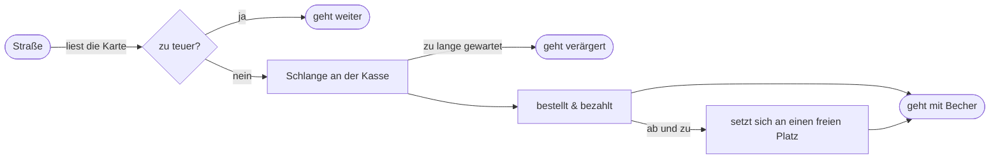
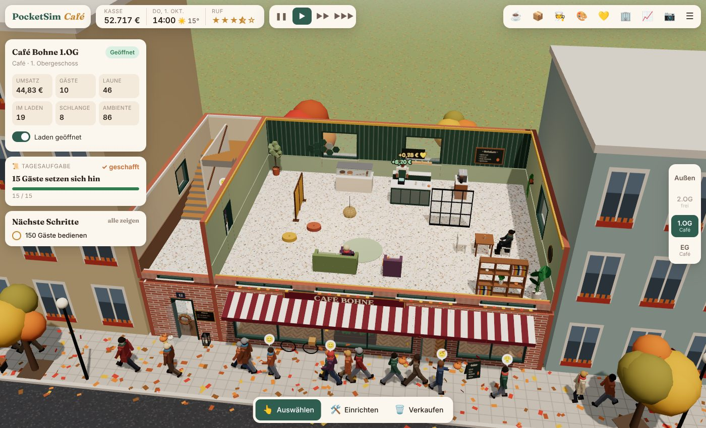
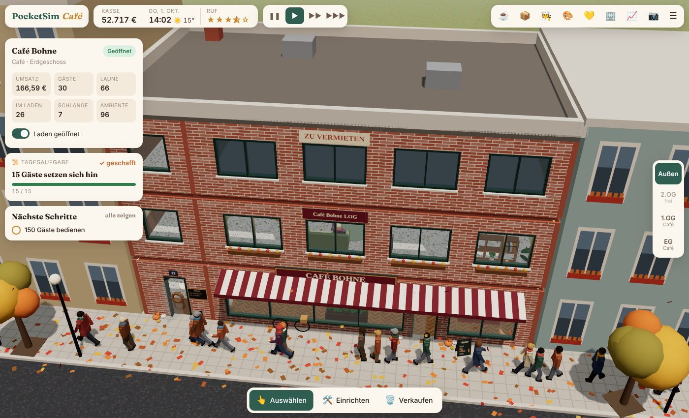

# PocketSim Café

> Du übernimmst ein leeres Ladenlokal in der Altstadt. Stell eine Theke auf, kauf eine Siebträgermaschine, stell Baristas ein und finde die richtigen Preise. Gäste kommen von der Straße herein, stellen sich an der Kasse an, bezahlen und setzen sich ab und zu an einen freien Tisch. Wenn das Café läuft, mietest du die oberen Etagen dazu.


PocketSim Café ist eine Wirtschaftssimulation im Browser. Die 3D-Grafik läuft mit Three.js. Es gibt keinen Build-Schritt und keinen Login, und das Spiel läuft am Desktop genauso wie auf dem Handy.

## Spielen

ES-Module brauchen einen kleinen Webserver, ein Doppelklick auf `index.html` reicht also nicht:

```bash
python3 -m http.server 8080
# dann http://localhost:8080 öffnen
```

Auf dem iPhone geht das mit Pythonista und `server.py` (inklusive Live-Reload).

| Aktion | Maus / Tastatur | Touch |
|---|---|---|
| Kamera drehen | linke Maustaste ziehen | ein Finger |
| Verschieben / Zoomen | rechte Maustaste / Mausrad | zwei Finger |
| Möbel platzieren | Klick | antippen (Vorschau), nochmal antippen |
| Möbel drehen | `R` | ⟳-Knopf |
| Etage wechseln | `Bild ↑` / `Bild ↓` | Etagenleiste rechts |
| Pause / Tempo | Leertaste, `1` `2` `3` | Knöpfe oben |

## So läuft ein Tag



- **Öffnungszeiten** 8–19 Uhr. Der Tag beginnt um 7 Uhr, nach Ladenschluss gibt es die Tagesabrechnung.
- **Kosten**: Wareneinkauf, Löhne (75 € je Barista und Tag) und Miete je Etage.
- **Theke mit Kasse**: Ohne Theke kann niemand bestellen. Jede Kasse braucht eine Barista. Zusätzliche Baristas helfen an der Maschine und machen den Service schneller.
- **Siebträger-Station** ist Pflicht für Kaffee und Tee, die **Kuchenvitrine** für Croissants, Kuchen, Muffins und Sandwiches.
- **Sitzplätze**: Ein Stuhl zählt nur mit einem Tisch daneben und dreht sich automatisch zu ihm. Sofa und Sessel brauchen keinen Tisch.
- **Ambiente**: Pflanzen, Lampen, Regale, Teppiche und die Musikbox machen das Café attraktiver. Das lockt mehr Gäste an und hebt die Laune.
- **Preise**: Jedes Produkt hat einen fairen Preis. Wer deutlich darüber liegt, verdient pro Tasse mehr, verliert aber Gäste und Laune.
- **Lager**: Backwaren verderben abends. Die Auto-Bestellung kauft nach, wenn ein Vorrat zur Neige geht, kostet aber 10 % Liefergebühr.
- **Ruf**: Die Laune jedes Gastes fließt in deinen Ruf ein, und der Ruf bestimmt, wie viele Leute hereinkommen.



## Mehrere Etagen

Das Gebäude hat drei Etagen. Das Erdgeschoss gehört dir von Anfang an, das 1. und 2. Obergeschoss kannst du unter **Etagen** anmieten und dort einen eigenen Laden eröffnen. Jeder Laden hat eigene Speisekarte, eigenes Lager und eigenes Personal. Gäste der oberen Etagen gehen durch den Eingang im Erdgeschoss und nehmen das Treppenhaus. Das Treppenhaus und die Wege dorthin dürfen nicht zugebaut werden.

Spielbar ist bisher nur das **Café**. Bäckerei, Buchladen und Boutique sind schon vorgesehen und als „bald verfügbar“ markiert.



## Aufbau des Codes

| Datei | Inhalt |
|---|---|
| `src/data.js` | Alle Zahlen: Etagen, Ladentypen, Möbel, Produkte, Waren, Nachfragekurve |
| `src/sim.js` | Die Simulation ohne Grafik: Raster, Bauen, Gäste, Kassen, Wirtschaft, Speichern |
| `src/path.js` | A*-Wegfindung auf dem Etagenraster |
| `src/models.js` | Prozedurale Low-Poly-Modelle für Möbel und Figuren |
| `src/render.js` | Three.js-Szene: Straße, Gebäude mit Schnittansicht, Figuren, Effekte |
| `src/ui.js` | HUD, Baukatalog, Fenster (Speisekarte, Lager, Personal, Etagen, Bilanz) |
| `src/main.js` | Spielschleife, Eingabe, Speichern im Browser |

### Einen neuen Ladentyp ergänzen

Alles Ladenspezifische steht in `src/data.js`:

1. In `SHOP_TYPES` den Typ auf `available: true` setzen und `defaultName` und `sitChance` angeben.
2. Produkte in `PRODUCTS` mit `shop: '<typ>'` anlegen und die verbrauchten Waren in `SUPPLIES` eintragen.
3. Einrichtung in `FURNITURE` mit `shops: ['<typ>']` anlegen. `register: true` macht ein Möbel zur Kasse. Für neue Ausstattungspflichten (wie `machine` oder `display` beim Café) muss `offerable()` in `sim.js` die Eigenschaft kennen.
4. In `src/models.js` ein Modell für jedes neue Möbel ergänzen.

Gäste, Schlangen, Sitzplätze, Treppen, Lager, Personal und Abrechnung funktionieren dann ohne weitere Änderungen.

## Tests

Die Simulation läuft ohne Browser und ist mit Node getestet:

```bash
npm test
```
