# UrbanEvolution

Wirtschaftssimulation im Browser mit Three.js und TypeScript. Du baust einen eigenen Supermarkt auf und führst ihn, später wächst daraus eine ganze Wertschöpfungskette: Rohstoffe, Produktion, Lager, Verkauf.

Das Spiel wird von **schräg oben** in einer **Management-Ansicht** gespielt, nicht in der Ego-Perspektive.

## Stand

**Meilenstein 1 – Grundgerüst** ✅

- Vite + TypeScript, Szene mit Himmel, Sonne und Schatten
- Testgelände aus `data/level/testgelaende.json`
- Management-Kamera: schwenken, drehen, zoomen, bleibt innerhalb des Geländes
- Feld unter der Maus wird markiert und oben angezeigt
- Tastenbelegung aus Daten, umbelegbar; die Hinweise unten lesen die aktuelle Belegung

**Meilenstein 2 – Entities, Komponenten und Daten-Registry** ✅

- Entity-/Komponenten-System (`src/ecs/`): Entities tragen Komponenten, die `World` verwaltet sie und meldet Änderungen über Ereignisse
- Inhalte werden beim Start aus `data/` geladen und geprüft (`src/content/`). Fehler nennen Datei und Feld.
- Regale, Kühlregal und Kasse im Testgelände sind Entities aus dem Bau-Katalog
- Debug-Anzeige (`F3`): geladene Daten, Objekte in der Welt und die **Summe der Bauteil-Werte**
- Automatische Tests mit Vitest

**Meilenstein 3 – Interaktion** ✅

- Objekte unter dem Mauszeiger werden erkannt und hervorgehoben (`src/interaction/Interactor.ts`)
- Gemeinsame Schnittstelle `InteractableComponent`: Jede Komponente bietet selbst an, was man mit ihr tun kann. Eine Entity kann mehrere solcher Komponenten tragen.
- Kontext unter dem Zeiger (`getContext()`, z. B. `regal`, `kasse`, `nichts`) und Hinweis am Zeiger wie „[Linksklick] Auswählen“, die Taste kommt live aus der Belegung
- Auswahl per Klick, Info-Fenster mit Zeilen aus den Komponenten, Abwählen per Klick ins Leere oder `Esc`

**Meilenstein 4 – Stats und HUD** ✅

- `PlayerState` (`src/state/`): Geld, XP und Level, getrennt von jeder Darstellung (Koop-Vorbereitung). Ausgaben, die das Konto übersteigen, werden abgelehnt; Beträge werden auf Cent gerundet.
- `GameClock`: Tag, Uhrzeit, Pause und drei Tempostufen. Die Simulation läuft im Spieltempo, die Kamera in Echtzeit.
- Top-Bar mit Kontostand (inklusive kurzer +/− Anzeige), Level mit XP-Balken, Wochentag/Tag/Uhrzeit und Tempo-Knöpfen
- Alles wird über Ereignisse aktualisiert (`changed`, `transaction`, `levelUp`, `minute`, `newDay`, `speedChanged`), nicht jeden Frame
- Meldungen (Toasts) für Level-Aufstieg und neuen Tag
- Debug-Anzeige mit Testknöpfen für Geld und XP

**Blender-Modelle** ✅

- 61 Bauelemente und 150 Produkte aus `data/3d/` (FBX aus Blender, Icons, Export-Listen)
- `npm run import:3d` erzeugt daraus `data/bau/*.json` und `data/produkte/*.json`
- `ModelLibrary` lädt die FBX-Dateien, teilt Geometrie zwischen Exemplaren und gibt allen Modellen **ein** gemeinsames Material mit der Palettentextur `2026 Palette.png`
- Produkte bekommen zusätzlich ihr Etikett aus `Produkt_Etiketten.png` (zweiter UV-Satz `UV_Icons`, über die Palettenfarbe gelegt)
- Das Testgelände ist aus den Modulen gebaut: Laden 14 × 10 m mit Schaufensterfront, Schiebetür, Ladenschild, Markisen, Kassen, Regalen, Kühlmöbeln, Obststand, Einkaufswagen, Gehweg und Lagerhof hinter dem Rolltor
- **Musterschau:** alle Bauteile und alle 150 Produkte – Adresse mit `#musterschau` öffnen

Noch offen: **Produktpreise** sind Startwerte je Kategorie (`"preisOffen": true`), bis die echte Preisliste da ist.

**Meilenstein 5 – Einkaufsterminal und Produkte** ✅

- Einkaufsterminal im Lagerhof (`data/bau/einkaufsterminal.json`, Funktion `"einkauf"`): Klick öffnet den Großhandel
- Großhandel-Fenster: alle Produkte aus `data/produkte`, nach Warenkategorie in Tabs, mit Icon, EK, VK und Kartonpreis; gesperrte Produkte zeigen „ab Level …“
- Gekauft wird kartonweise (`"gebinde"` = Stück pro Karton). Bezahlt wird der EK sofort, die Ware steht als **Kartons auf den Europaletten** (je 12 Plätze)
- Geprüft wird vor dem Bezahlen: Auswahl leer, Produkt gesperrt, **zu wenig Lagerplatz**, zu wenig Geld – ein Fehler ändert nichts
- Kartons sind Entities: anklicken zeigt Produkt, Stückzahl, Einkaufs- und Verkaufswert; oben drauf steht eine Packung des Produkts
- Pro Taste gilt nur das wichtigste Angebot (`prioritaet`): Klick aufs Terminal öffnet den Einkauf statt es auszuwählen

**Kleiner Start-Laden, Baumenü, Einräumen und Personal** ✅

- Das Spiel startet jetzt im **leeren Laden 8 × 6 m** (`data/level/start.json`): Fliesen, Wände, Schaufensterfront, Einkaufsterminal und zwei Europaletten – sonst nichts. Testgelände und Musterschau gibt es weiter über `#testgelaende` und `#musterschau`
- **Baumenü** (`B` oder Knopf „Bauen“): Kategorien aus `data/baumenue/standard.json` als Tabs, Katalog mit Icon und Preis. Vorschau folgt der Maus (grün = frei, rot = geht nicht), `R` dreht, Linksklick baut, `Esc` bricht ab
- Bauregeln (`src/building/placement.ts`): Objekte brauchen Boden, dürfen sich nicht mit Objekten oder Wänden überschneiden, kosten Geld und müssen freigeschaltet sein. **Abreißen** gibt die Hälfte zurück, **Verschieben** ist kostenlos; beides nur, wenn keine Kartons bzw. keine Ware darauf liegen
- **Einräumen von Hand:** Karton anklicken → er ist „in der Hand“ (Anzeige unten) → Regal anklicken → Ware wandert in die Fächer und ist im Regal zu sehen. Gekühlte Ware passt nur ins Kühlregal. Handarbeit bringt XP (`data/arbeit/standard.json`)
- **Personal** (`P` oder Knopf „Personal“): jeden Tag neue Bewerbungen, einstellen, entlassen. Auffüller holen selbstständig Kartons von den Paletten und räumen sie ein. Der Lohn wird zu Beginn jedes Tages fällig – reicht das Geld nicht, kündigt die Person. Werte in `data/personal/`


**Voxel-Stil** ✅

- Alle Blender-Modelle erscheinen als Würfel: beim ersten Laden einmal umgerechnet, Farben aus Palette und Etikett. Gebäude und Einrichtung mit 2,5 cm, Produkte mit 4 mm – Flaschen, Deckel und Etiketten bleiben erkennbar
- **Schnell trotz Details:** gleichfarbige Würfelflächen werden zu großen Rechtecken zusammengefasst (Greedy Meshing), alle Exemplare teilen sich eine Geometrie, gleiche Ware im Regal ist ein einziger Zeichenaufruf (InstancedMesh), und aus der Ferne werden automatisch gröbere Detailstufen gezeigt
- Figuren für Personal (und bald Kunden) sind aus Würfeln gebaut: Haut, Frisur, Kleidung aus `data/figuren/standard.json`; beim Personal hat das Oberteil die Farbe der Rolle
- Alles einstellbar in `data/voxel/standard.json`; `?stil=lowpoly` in der Adresse zeigt die Original-Modelle (z. B. `…/?stil=lowpoly#testgelaende`)

**Spielablauf: Kunden, Kasse, Ruf, Tagesbericht** ✅

- **Kunden** kommen während der Öffnungszeiten (08–20 Uhr) über den Gehweg, suchen ihre Wünsche in den Regalen, legen sie in den Korb und stellen sich an der Kasse an
- **Kassieren:** Klick auf die Kasse, wenn jemand dran ist (bringt extra XP) – oder einen **Kassierer** einstellen, der die Kasse besetzt
- Fehlt Ware, gibt es keine Kasse oder dauert es zu lange, sinkt der **Ruf** – und damit der Andrang. Zufriedene Kunden heben ihn
- **Wegfindung** (A* auf einem 25-cm-Raster): Kunden und Personal laufen um Regale herum und durch Türen (`"durchgang": true`)
- Um Mitternacht kommt der **Tagesbericht**: Kunden, Umsatz, Ausgaben, Ergebnis, Ruf und die am häufigsten vermissten Produkte (= was man einkaufen sollte). Nachts im leeren Laden läuft die Zeit schneller
- **Ziele** für den Einstieg links oben (`data/ziele/start.json`) mit Belohnungen
- Werte: `data/kunden/standard.json` (Öffnungszeiten, Andrang je Stunde, Geduld, Ruf), `data/navigation/standard.json`, Kassenplätze in `data/bau/kasse_*.json` (`"kasse"`)

**Voxel-Editor (Entwicklerwerkzeug)** ✅

Der Editor gehört zur Entwicklung, nicht zum Spielen: Mit ihm entstehen neue Spielinhalte, die danach fest zum Projekt gehören. Im Spiel gibt es deshalb keinen Editor-Knopf mehr.

- Öffnen: `#editor` in der Adresse, im Hauptmenü „Voxel-Editor (Entwicklung)“ oder in der Debug-Anzeige (`F3`) – die beiden Knöpfe nur mit `npm run dev`
- **Werkzeuge:** Setzen `1`, Entfernen `2`, Malen `3`, Füllen `4` (zusammenhängende gleiche Farbe), Farbe ersetzen `5` (überall im Modell), Pipette `6` (oder `Alt` + Klick)
- **Formen:** Punkt `P`, Linie `L`, Rechteck `R` – Linie und Rechteck zeigen beim Ziehen eine Vorschau. Pinselgröße 1–5 mit `[` `]`. Gezogen wird immer in der Schicht, in der man angefangen hat
- **Spiegeln beim Zeichnen:** links/rechts `M`, vorne/hinten `N` – beide gleichzeitig gehen auch
- **Ganzes Modell:** drehen `D`, spiegeln, verschieben (Pfeiltasten, `Bild ↑` `Bild ↓`), zuschneiden, Bauraum und Würfelgröße (0,4 mm … 10 cm) ändern. Alles lässt sich rückgängig machen (`Strg+Z` / `Strg+Y`)
- **Neu …** mit Größenvorlagen (kleines Objekt, Regal, Theke/Maschine, Wandmodul, Bodenfliese, Deckenleuchte, Produkt)
- **Ansicht:** „Schnitt bis Höhe“ blendet obere Schichten aus, eine **Figur** (1,70 m) zeigt den Maßstab, Koordinaten und Farbe unter dem Zeiger stehen unten in der Statuszeile
- **Farben:** Palette der Spielmodelle, freie Farbwahl und die zuletzt benutzten Farben
- **Modelle aus dem Spiel:** jedes Bauteil und Produkt laden – entweder **„Als neues Modell“** (Kopie, ein eigenes neues Teil) oder **„Original bearbeiten“**: Die Änderung ersetzt das Modell überall im Spiel (alle Exemplare, auch Ware im Regal). Die Datei heißt `data/modelle/original_<id>.json` und merkt sich mit `ersetzt` und `ursprung`, welches Modell sie ersetzt und wo es liegt – Drehen, Zuschneiden und Größe ändern verschieben nichts. Löschen stellt das Original wieder her; die Blender-Datei bleibt unangetastet. Glasflächen werden dabei nicht übernommen
- **Im Spiel:** Art (Dekoration, Regal oder „Nur Modell“), **Reiter im Baumenü** (alle Reiter aus `data/baumenue`, z. B. Einrichtung, Licht, Deko), Preis. Der Reiter bestimmt auch, wie das Teil gebaut wird – im Reiter „Licht“ hängt es an der Decke. Bei Regalen erkennt der Editor die Regalböden selbst; vorne ist +X (grüner Pfeil)
- **„Nur Modell“** erscheint nicht selbst im Baumenü – ein Bauteil in `data/bau` verweist mit `"model": "eigen/<id>"` darauf (so sind Backstation, Saftpresse und Aufschnittmaschine gebaut)
- **Speichern** (`Strg+S`): schreibt `data/modelle/<id>.json` ins Projekt (nur mit `npm run dev`). Sonst „Exportieren“ und die Datei von Hand nach `data/modelle/` legen. Die offene Arbeit wird zusätzlich als Entwurf im Browser gesichert und nach dem Neuladen wiederhergestellt
- **Modelle im Projekt:** Liste aller Dateien in `data/modelle` mit Art und Reiter – öffnen, weiterbearbeiten, löschen
- Hilfe mit allen Tasten: `H` oder „? Hilfe“

**Etappe 1 – Speichern, Laden, Haupt- und Pausemenü** ✅

- **Hauptmenü** beim Start: Weiterspielen, Neues Spiel, Spielstand laden, Datei laden, Darstellung (Voxel/Low-Poly)
- **Pausemenü** mit `Esc` (wenn nichts anderes offen ist): Speichern, Laden, Als Datei sichern, Hauptmenü
- **Drei Speicherplätze** plus automatischer Platz, der zum Tagesende geschrieben wird. Gespeichert wird der Zustand ohne Darstellung (`src/save/`): Geld, Level, Uhr, Bauteile, Ware, Personal, Preise, Statistik, Grundstücke, Versorgung, Maschinen
- Jede Komponente, die etwas zu merken hat, speichert sich selbst (`persistKey`, `saveState`, `loadState`)

**Etappe 2 – Preise und Bilanz** ✅

- **Sortiment** (`O`): eigener Verkaufspreis je Produkt. Kunden vergleichen mit dem empfohlenen Preis – bis 10 % darüber kaufen fast alle, danach sinkt die Kaufchance; ab dem 2,5-Fachen kauft niemand. Werte in `data/kunden/standard.json` → `preis`
- Zu teure Ware lässt Kunden ohne Kauf weitergehen („zu teuer“ im Tagesbericht)
- **Bilanz** (`L`): Umsatz, Ergebnis, Kunden und Ruf der letzten 7 Tage, dazu Umsatz/Ausgaben je Tag und der Ruf als Diagramm – auch als Tabelle (14 Tage)

**Etappe 3 – Ausbau: Grundstücke, Wände, Gehweg** ✅

- **Grundstücke** im Baumenü (Reiter „Grundstücke“): Ost, West und Hof kosten Geld und werden mit dem Level freigeschaltet (`data/level/start.json` → `grundstuecke`). Gebaut werden darf nur auf eigenem Grund
- **Einrasten:** Böden im Raster am gleichartigen Boden, Wände an Bodenkanten (Außenseite nach außen, `R` kehrt um), Eckpfeiler an Ecken, Anbauteile an das Wandmodul. Abreißen einer Wand nimmt ihre Anbauteile mit
- Gehweg und Hof zählen als Außenfläche (`"aussen": true`), nicht als Ladenfläche

**Etappe 4 – Wertschöpfung: Versorgung, Rohstoffe, Maschinen** ✅

- **Versorgung** (`V`): Strom und Wasser über den Hausanschluss. Grundlast = Summe der Bauteil-Werte, dazu laufende Maschinen. Reicht der Anschluss nicht, starten keine Maschinen und neue Verbraucher lassen sich nicht bauen. Ausbaustufen und Preise in `data/versorgung/standard.json`, abgerechnet um Mitternacht
- **Rohstoffe** (`data/rohstoffe/`) sind eigene Waren: Man kauft sie im Großhandel, sie kommen nicht ins Regal
- **Maschinen** (Backstation, Saftpresse, Aufschnittmaschine) im Reiter „Maschinen“: anklicken, Rezept wählen, starten. Die Maschine holt die Rohstoffe selbst aus dem Lager und stellt das Ergebnis als Karton zurück – eingeräumt wird es wie gekaufte Ware. Eine Lampe zeigt den Zustand
- **Rezepte** in `data/rezepte/` (Eingang, Ausgang, Dauer, Freischalt-Level)

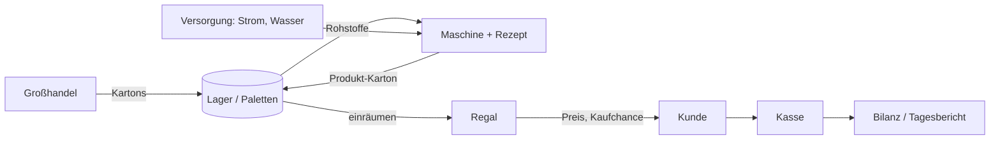

**Etappe 7 – Lager und Logistik** ✅

- **Lieferung per LKW:** Bestellte Ware kommt nicht mehr sofort, sondern zu festen Lieferzeiten (alle zwei Stunden) oder per **Express** (nach 20 Minuten, teurer). Lieferkosten: Grundbetrag + je Karton. Der Lagerplatz wird beim Bestellen eingeplant
- Der LKW hält **auf der Straße** vor dem Laden – oder fährt **rückwärts an ein Ladetor** (siehe Etappe 8)
- **Abladen:** von Hand (Karton auf der Ladefläche anklicken, dann einen Lagerplatz – bringt XP), durch **Lageristen** (neue Rolle im Personal) oder nach der Wartezeit durch den Fahrer gegen Gebühr. Ist kein Platz frei, nimmt er die Ware zurück und erstattet den Einkaufspreis
- **Umlagern von Hand:** jeden Karton auf jede freie Ablage stellen (Palette, Palettenregal, Gitterbox, Rollcontainer)
- **Lager-Fenster** (`G`): Belegung der Lagerplätze, LKW am Laden, Lieferungen unterwegs, Bestand nach Ware
- **25 neue Voxel-Assets** (`npm run modelle:lager`): Palettenregal, Gitterbox, Rollcontainer, Gabelstapler, Hubwagen, Sackkarre, Stehleiter, Feuerlöscher, Spind, Packtisch, Paletten, Folienpalette, Kartonstapel, Lagerschild, Poller, Mülltonne, Papiercontainer, Hallenstrahler, Trapezblech-Wände, Sektionaltor, Beton- und Asphaltböden, Liefer-LKW. Alle außer dem LKW stehen in der Musterschau (`#musterschau`, rechts)
- Modelle ohne eigenes Icon bekommen ihr **Vorschaubild automatisch** aus den Würfeln
- Werte: `data/logistik/standard.json`, Strecke im Level unter `"anlieferung"`

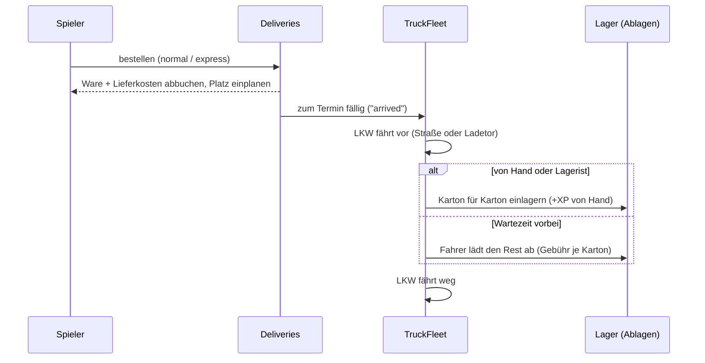

**Etappe 8 – Schönes Lager, Einkaufswagen, Cosy-Look** ✅

- **Lager selbst bauen – angebaut oder freistehend:** Im Reiter **Lager** liegt jetzt der ganze Baukasten: Beton- und Asphaltböden, Trapezblech-Wände (salbeigrün), Lichtband, Sektionaltor, **Ladetor**, Palettenregal, Holzregal, Gitterbox, Rollcontainer und Deko (Holzkisten, Fass, Paletten …). Für ein freistehendes Lager gibt es das neue Grundstück **Gewerbehof** (rechts neben dem Laden, ab Level 2)
- **Ladetor statt Rampenblock:** ein Wandmodul, ebenerdig in die Lagerwand eingebaut – mit Torabdichtung, Puffern, Ampel und warmer Torleuchte. Der LKW setzt außen rückwärts an und klappt seine **Ladebordwand** auf den Boden
- **LKW finden ihren Weg selbst:** Ein eigenes Fahrraster (`NavGrid`, Modus „fahren“) kennt Gelände, Asphalt und Gehwege und weicht Gebäuden aus. Ist vor einem Tor kein Platz zum Rangieren, kommt eine Meldung und der LKW hält auf der Straße
- Damit Personal ins freistehende Lager kommt: einen Weg aus **Asphalt** vom Gehweg bis zu einem Tor legen
- **Einkaufswagen:** Wer mindestens 3 Teile kaufen will, holt sich einen leeren Wagen aus der **Wagenbox** (vor dem Laden). Die Ware liegt sichtbar im Wagen, an der Kasse auf dem Band; nach dem Bezahlen **packen** alle Kunden hinter der Kasse ein und bringen den Wagen zurück
- **Dach:** Herausgezoomt liegt ein Dach auf allen Innenräumen, beim Hereinzoomen, beim Bauen oder mit der Taste **T** („Dach“) verschwindet es (`data/baumenue/standard.json` → `dach`)
- **Rampenabfahrt (abgesenkt):** rastet außen vor einem Ladetor ein. Der LKW fährt rückwärts die Schräge hinunter (er neigt sich mit) und steht unten 1,1 m tiefer – seine Ladefläche ist bündig mit dem Hallenboden, eine Ladebordwand braucht es nicht. Länge, Tiefe und Breite: `data/bau/rampenabfahrt.json` → `absenkung`
- **Gelände formen:** Reiter **Gelände** im Baumenü – Boden **anheben**, **absenken** oder **ebnen**, drei Pinselgrößen, linke Maustaste halten. Bewegte Erde kostet Geld (je m³), steile Stellen werden erdig. Nur auf eigenen Grundstücken und nicht unter Gebautem; gebaut wird nur auf ebenem Boden. Werte: `data/gelaende/standard.json`; die Höhen liegen im Spielstand (`src/world/Terrain.ts`, Darstellung `src/world/TerrainView.ts`, Werkzeug `src/building/TerrainTool.ts`)
- **Gelände im Voxel-Stil:** Hügel und Gruben bestehen aus 0,5-m-Säulen in Stufen zu 25 cm – oben Gras mit schmaler Graskante, an den Seiten Erde in Schichten (`stufe` in `data/gelaende/standard.json`)
- **Böden flächig aufziehen:** Bei jedem Bodenteil (Fliesen, Beton, Asphalt, Gehweg …) die Maustaste gedrückt halten und ein Rechteck ziehen – grün wird gebaut, rot geht nicht (belegt, fremder Grund, zu wenig Geld). Beim Loslassen entstehen alle Platten auf einmal (höchstens 20 × 20)
- **Bodenmarkierungen selbst malen:** Reiter **Markierungen** im Baumenü
  - **Pinsel** (frei malen), **Linie** (ziehen, Enden rasten auf 25 cm ein), **Radierer**
  - 10 Farben plus eigene Farbe aus dem Farbwähler, Breiten 8–60 cm, Farbe kostet je m²
  - **18 Stempel:** Pfeile, Parkplatz, Zebrastreifen, Gefahrenstreifen, Haltelinie, Stellfläche, Sperrfläche, Kreis, Punkt, Fußspuren, Herz, Stern, Schriften („Eingang“, „Ausgang“, „Kasse“, „Lager“, „Willkommen“) – in 4 Größen, mit der Dreh-Taste in 45°-Schritten drehbar
  - Eigene Stempel: in `data/markierungen/standard.json` unter `stempel` eintragen – Formen als SVG-Pfad im 100 × 100-Feld (`pfad`, optional `linie` für Umrisse) oder als `text`
  - Die Farbe liegt auf einer Malschicht über Rasen und jeder Bodenplatte (`src/world/PaintLayer.ts`, Werkzeug `src/building/PaintTool.ts`) und wird als Bild im Spielstand gespeichert
- **Cosy-Look:** wärmeres Licht von oben und vom Boden, warme Sonnenfarbe, weiche Schatten, leichter Dunst in der Ferne (`data/licht/standard.json` → `stimmung`). Neue gemütliche Deko (`npm run modelle:deko`): Wagenbox, Holzbank, Straßenlaterne (leuchtet), Lavendelkübel, Fahrradständer, Kreidetafel, Lichterkette für die Fassade (leuchtet), Holzdielen. Der Start-Laden hat schon Bank, Laternen, Lavendel und eine Wagenbox

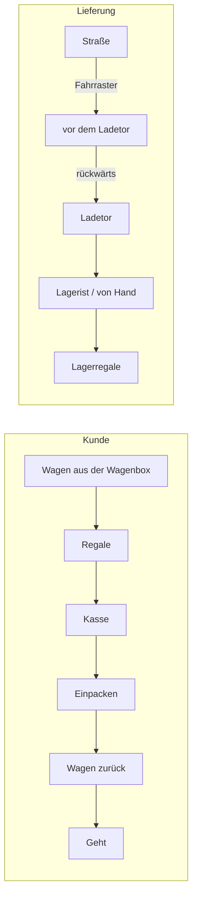

**Etappe 9 – Feste Regalplätze, Einkäufer, Ladeneinrichtung** ✅

- **Feste Regalplätze:** Klick auf ein Regal (ohne Karton in der Hand) öffnet **Belegen**: je Fach ein festes Produkt wählen oder frei lassen, „Aktuelle Ware festlegen“ übernimmt, was gerade drin steht, „auf alle“ belegt die freien Fächer genauso. Ein festes Fach nimmt nur sein Produkt – auch leer. Auffüller räumen ein Produkt mit festen Fächern nur noch dorthin (`src/components/ShelfComponent.ts`, Fenster `src/ui/ShelfWindow.ts`). Die Belegung steht im Spielstand
- **Neue Rolle Einkäufer** (`data/personal/rollen.json`): geht zum Einkaufsterminal und prüft jede Stunde (Spielzeit) die Bestände. Nachgekauft wird alles, was einmal im Regal stand oder einem Fach fest gehört – so viel, wie in seine Regalplätze passt, plus ein Reserve-Karton. Die knappsten Produkte zuerst, nur über dem Mindestguthaben und solange Lagerplatz frei ist. Im **Sortiment** (`O`) lässt sich je Produkt der Haken **Nachkaufen** abwählen. Werte: `data/personal/standard.json` → `einkauf`; Logik ohne Grafik in `src/economy/Buyer.ts`, im Spiel `src/world/BuyerSystem.ts`
- **Schienenleuchten nur an Lichtschienen:** Lichtleiste, Pendelleuchten und Schienen-Deckenstrahler lassen sich nur unter eine Lichtschiene hängen. Sie rasten auf deren Mittellinie ein (gerade Schienen im 25-cm-Raster, Kreuz/T/Kurve in der Mitte) und übernehmen die Richtung; mit „Drehen“ quer dazu. Wird die Schiene abgerissen, gehen die Leuchten mit. In den Daten: `"schiene": true` bzw. `"anSchiene": true`
- **20 neue Voxel-Assets** (`npm run modelle:store`):
  - Regale: Landhausregal, Mittelregal Holz, Brotregal mit Körben, Obststand mit Kisten, Tiefkühltruhe (gekühlt), Getränkeregal, Kassenregal, schmales Wandregal
  - Schilder (neuer Reiter **Schilder**): Hängeschilder Obst & Gemüse, Getränke, Backwaren, Kühlung, Drogerie, Angebote, Kasse (hängen von der Decke, Schrift auf beiden Seiten), Aufsteller „Angebot“, Infotafel mit Öffnungszeiten; für die Fassade ein Leuchtschild „OFFEN“ (leuchtet) und ein Nasenschild
  - Alle stehen in der Musterschau (`#musterschau`, unten rechts)
- Die Pixel-Schrift der Voxel-Modelle kennt jetzt auch Ä, Ö, Ü, Ziffern und Zeichen wie & und %, und sie schreibt auf jede Seite eines Modells (`scripts/lib/voxel-model.mjs`)

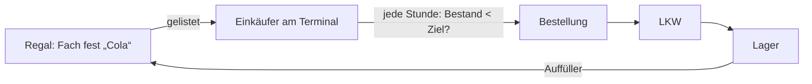

**Etappe 10 – Cozy-Kamera, Effekte, Klang, Balancing, Testmarkt** ✅

- **Cozy-Kamera** (`data/kamera/standard.json`): nah heran wird der Blick flacher (34°), weit weg steiler (56°); gezoomt wird zum Mauszeiger hin, Schwenken mit der Maus gleitet mit Schwung aus, ohne Eingabe „atmet“ die Kamera ganz leicht
- **Cozy-Look** (`src/render/CozyLook.ts`, Werte unter `look`): Lampen, Leuchtschilder und Lichterketten glühen (Bloom, nachts stärker), oben und unten leichte Miniatur-Unschärfe (Tilt-Shift, je weiter weg desto stärker), weiche Vignette, etwas wärmere Farben. Abschaltbar unter Menü → Einstellungen
- **Bewegungen und Effekte** (`src/fx/`, Werte in `data/effekte/standard.json`): Die Bauvorschau gleitet dem Zeiger nach, dreht sich weich und schwebt; Hingestelltes ploppt mit einem kleinen Hüpfer auf, Abgerissenes dreht sich weg und verpufft, Staubwölkchen aus Voxel-Würfeln. An der Kasse springen Münzen, der Betrag schwebt hoch, Kunden zeigen ein Pixel-Herz; Level-Aufstieg und erreichte Ziele funkeln; fahrende LKW lassen Wölkchen aus dem Auspuff. Fenster federn auf, Meldungen gleiten herein, Knöpfe geben nach
- **Töne und Musik** (`src/audio/AudioSystem.ts`, `data/audio/standard.json`): alles live mit WebAudio erzeugt, ohne Audiodateien – Holz-„Tock“ beim Bauen, Klick beim Drehen, Puff beim Abriss, Ka-Ching an der Kasse, Einräumen, Fehler, Level-Up, Ziel, LKW-Hupe. Dazu gemütliche Lo-Fi-Musik, die sich selbst schreibt (Akkordfolgen, Bass, Melodie aus der Pentatonik, leises Hi-Hat, leichter Swing), nachts ruhiger. Lautstärken unter Menü → Einstellungen, Taste **M** schaltet stumm. Töne lassen sich in den Daten als Rezepte (Welle, Tonhöhe, Gleiten, Dauer, Filter) ändern
- **Kassen gedreht:** Kunden stehen jetzt auf der richtigen Seite (Layout `kasse` in `data/bau/kasse_schwarz.json` und `store_checkout_01.json`)
- **Schienenleuchten repariert:** Sie hängen an der Unterkante der Schiene (vorher 60 cm zu hoch), und Deckenteile werden auf Deckenhöhe angezielt – ein Klick auf die sichtbare Schiene trifft
- **Balancing** mit Messung statt Gefühl: `npm run sim` lässt einen Laden ohne Grafik mehrere Tage laufen (`scripts/sim/balancing.sim.ts`). Neu: Mehr verschiedene Produkte bringen mehr Kunden und größere Einkäufe, mehr Kassen erlauben mehr Andrang, der Ruf wächst über rund eine Woche statt an einem Tag, Grundstücke sind günstiger. Zahlen und Begründung: [docs/balancing.md](docs/balancing.md)
- **Großer Testmarkt:** Hauptmenü → **Testmarkt** (oder Adresse `…/#testmarkt`): Laden 20 × 6 m mit allen Regaltypen, Kühlung, 3 Kassen, Lichtschienen, Hängeschildern und Bodenmarkierungen; Lager 20 × 6 m mit Palettenregalen und Ladetor zum Gewerbehof; 7 Angestellte, Level 10, alles freigeschaltet. Neu erzeugen: Entwicklungsserver starten, dann `node scripts/make-testmarkt.mjs`

**Etappe 11c – Cozy Café: eigener Forschungsbaum, neue Möbel** ✅

- **Forschung mit Reitern** (`data/forschung/standard.json` → `baeume`, Knoten mit `"baum"`): *Supermarkt* und *Café*. Voraussetzungen aus einem anderen Baum stehen als Hinweis auf der Karte (Café-Ecke ↖ Backstube); am Reiter zeigt eine Zahl, wie viel gerade erforschbar ist
- **Café-Baum:** Café-Ecke → Wohnzimmer-Ecke → Barista-Bar · Café-Ecke → Kuchentheke → (Kaffeerösterei → Eigene Kaffeemarke, bald) · Café-Ecke → Pflanzen & Licht → Terrasse
- **Neue Assets** (`npm run modelle:cafe`): Samtsofa (2 Plätze), Ohrensessel, Couchtisch, Stehlampe (leuchtet), Bücherregal, Kuchenvitrine (Bedientheke wie der Tresen) mit Käsekuchen, Schokokuchen und Erdbeertorte, Monstera, Wandregal mit Tassen, Rattan-Pendelleuchte (leuchtet), Bartresen mit drei Hockern, Terrassentisch mit Sonnenschirm, Blumenkasten
- **Sitzen überall:** Sofa, Sessel, Barhocker und Terrasse haben Sitzplätze; Plätze können eine Blickrichtung haben (`"sitze": [[x, z, grad]]`), hingesetzt wird von der nächsten Kante aus. Auch Kuchen-Käufer setzen sich

**Etappe 11b – Café-Ecke** ✅

- **Forschung „Café-Ecke“** (nach der Backstube, ab Level 3, 40 Ideen): Kaffeemaschine, Café-Tresen, Bistrotisch mit Stühlen, Hängeschild „KAFFEE“, Sortiment Café, Rezepte und die neue Rolle **Barista**
- **Kaffeemaschine** (Maschine): *Kaffee brühen* (1 kg Bohnen → 24 Kaffee to go) und *Cappuccino zubereiten* (Bohnen + Barista-Milch → 20 Cappuccino); neue Rohstoffe Kaffeebohnen und Barista-Milch
- **Café-Tresen** = Bedientheke (`"kasse": { "bedienung": true }` + Regalfach): Kaffee gibt es nicht zum Selbstnehmen. Gäste stellen sich am Tresen an und bestellen; **du bedienst per Klick** oder ein **Barista** übernimmt (bereitet zu – 2,5 s je Becher – und kassiert). Bezahlt wird gleich am Tresen, auch was sonst im Korb liegt. Der Auffüller füllt das Fach des Tresens mit den Bechern aus der Kaffeemaschine
- **Gemütlich sitzen:** Wer Kaffee gekauft hat, setzt sich danach an einen freien Bistrotisch (18–40 s, Gedankenblase „Herrlich, ein Kaffee!“) und geht dann (`data/kunden/standard.json` → `cafe`, Plätze in `data/bau/bistrotisch.json` → `sitze`)
- Der Barista bewirbt sich erst, wenn die Café-Ecke erforscht ist (`data/personal/rollen.json` → `forschung`)
- Modelle: `npm run modelle:cafe` (`scripts/make-cafe-models.mjs`)

**Etappe 11a – Forschungsbaum** ✅

- **Forschung (Taste F):** Mit jeder XP sammelst du nebenbei Ideen 💡 (`data/forschung/standard.json`: 0,3 Ideen je XP). Damit schaltest du im Baum neue Produktlinien, Maschinen und Bauteile frei – ohne Zeitdruck, sofort mit Funkeln. Ein Knoten braucht ein Mindestlevel, seine Voraussetzungen und genug Ideen
- **Zweige** (`data/forschung/baum.json`): Backstube → Saftbar → Café-Ecke → Kaffeerösterei · Kühlregale → Feinkost → Tiefkühltruhen · Haushalt & Drogerie → Modeladen → Einkaufszentrum · Lagerlogistik → Gabelstapler → Zentrallager → Fuhrpark / Produktionshalle · Solardach → Pfandautomat. Knoten mit `"bald": true` sind Vorschau auf die nächsten Etappen
- Was ein Knoten freischaltet (`schaltetFrei`: `bau`, `rezepte`, `kategorien`), wird beim Laden an den Inhalten eingetragen und überall geprüft: Baumenü, Einkauf, Regale, Sortiment, Maschinen und Kundenwünsche (`src/economy/Research.ts`, Fenster `src/ui/ResearchWindow.ts`)
- Alte Spielstände (auch der Testmarkt) bekommen beim Laden alles erforscht, was bis zum aktuellen Level möglich ist

**Etappe 10b – Mehr Leben, besseres Licht** ✅

- **Licht ohne Ausbrennen:** Lampen, die nah beieinander hängen, teilen sich eine Lichtquelle in ihrer Mitte (`src/world/LampLights.ts`). Die Helligkeit wächst nur gedämpft, das Licht sitzt etwas unter den Leuchten – zehn Leuchten an einer Schiene machen keinen weißen Fleck mehr. Werte: `data/licht/standard.json` → `lampen.buendeln`
- **Figuren leben:** Beim Gehen wippen und schwanken alle Figuren im Schritttakt, im Stehen atmen sie und schauen sich um (`src/components/FigureComponent.ts`)
- **Leben in der Straße** (`src/world/Ambience.ts`, Werte in `data/leben/standard.json`, Wege im Level unter `leben`): Passanten schlendern über den Gehweg (manche mit Hund, manche bleiben am Schaufenster stehen), Autos auf beiden Spuren (nachts mit Scheinwerfern und Rücklichtern), Tauben picken und fliegen auf, wenn jemand kommt, Vogelschwärme ziehen vorbei, Schmetterlinge tanzen um die Lavendelkübel, Wolkenschatten ziehen über die Szene. Neue Modelle: drei Autos, Hund, Taube, Straßenbaum (baubar unter Deko) – `npm run modelle:leben`
- **Gedankenblasen der Kunden:** „Kein Mozzarella?“, „Puh, 3,50 € …“, „Schnäppchen!“, „Schöner Laden!“ – man sieht sofort, was fehlt und was zu teuer ist
- **Umgebungsgeräusche:** Vogelzwitschern am Tag, Grillen in der Nacht, vorbeifahrende Autos, auffliegende Tauben
- **Ideen für die nächsten Etappen:** [docs/ideen.md](docs/ideen.md)

**Licht: Tag und Nacht, leuchtende Lampen** ✅

- Sonne, Umgebungslicht und Himmel folgen der Uhrzeit: Sonnenaufgang, Dämmerung in warmen Farben, dunkle Nacht (`data/licht/standard.json`)
- **Lampen leuchten:** Bauteile mit `"licht"` (Pendelleuchte, Deckenstrahler, Schienenleuchten, Wandlampe, Hallenstrahler) bekommen eine glühende Leuchtfläche und echtes Licht. Damit das Spiel schnell bleibt, gibt es eine feste Zahl Lichtquellen, die immer zu den Lampen nahe der Kamera wandern; nachts sind sie stärker

## Starten

Du brauchst [Node.js](https://nodejs.org) (Version 20 oder neuer).

```bash
npm install      # einmalig: Abhängigkeiten holen
npm run dev      # Entwicklungsserver starten, Adresse steht dann im Terminal
```

Weitere Befehle:

| Befehl | Was passiert |
|---|---|
| `npm test` | automatische Tests (Entities, Daten, Modelle, Voxel) |
| `npm run import:3d` | Blender-Exporte aus `data/3d` in die Spieldaten übernehmen |
| `npm run check` | nur Typprüfung |
| `npm run build` | Typprüfung und fertiger Build in `dist/` |
| `npm run preview` | den Build lokal ansehen |
| `npm run modelle:maschinen` | Voxel-Modelle der Maschinen neu erzeugen (`data/modelle/`) |
| `npm run modelle:deko` | gemütliche Deko und Wagenbox neu erzeugen |
| `npm run modelle:lager` | Voxel-Modelle für Lager und Logistik neu erzeugen (Baukasten: `scripts/lib/voxel-model.mjs`) |
| `npm run build:artifact` | Build für claude.ai-Artifacts in `dist-artifact/` (Modelle als JS eingebettet, weil Artifacts keine .fbx-Dateien ausliefern) |

Im Entwicklungsmodus ist das Spiel in der Browser-Konsole als `urbanEvolution` erreichbar, z. B. `urbanEvolution.view.zoom(-2)`.

## Steuerung

| Aktion | Standard |
|---|---|
| Kamera schwenken | `W` `A` `S` `D` oder Pfeiltasten, mittlere Maustaste ziehen |
| Kamera drehen | `Q` / `E`, rechte Maustaste ziehen |
| Zoomen | Mausrad |
| Zeit anhalten / weiter | `Leertaste` |
| Tempo 1 / 2 / 3 | `1` `2` `3` |
| Objekt auswählen | Linksklick |
| Auswahl aufheben | Klick ins Leere oder `Esc` |
| Baumenü auf/zu | `B` |
| Personal auf/zu | `P` |
| Sortiment und Preise | `O` |
| Bilanz | `L` |
| Versorgung | `V` |
| Lager & Lieferungen | `G` |
| Karton umlagern / LKW abladen | Karton anklicken, dann eine Palette oder ein Lagerregal |
| Bauvorschau drehen | `R` |
| Karton aufnehmen / ins Regal | Linksklick auf Karton, dann auf Regal |
| Abbrechen, Fenster schließen, Karton abstellen | `Esc` (schließt immer nur das Oberste) |
| Pausemenü | `Esc`, wenn nichts anderes offen ist |
| Kunden kassieren | Linksklick auf die Kasse, wenn jemand dran ist |
| Debug-Anzeige an/aus | `F3` |

Die Belegung steht in `data/eingabe/standard.json`.

## 3D-Modelle

Die Modelle kommen als FBX aus Blender nach `data/3d/`:

```
data/3d/
  Baubar/<Kategorie>/SM_Build_*.fbx      Bauelemente
  Baubar/_export_liste.csv               Name, Kategorie, Maße in cm, Datei
  Produkte/<Nr>_<Kategorie>/SM_*.fbx     Produkte
  Produkte/_export_liste.csv
  Icons_Baubar/T_Build_*.png             Vorschaubilder fürs UI
  Icons_Produkte/T_Icon_*.png
  2026 Palette.png                       Farbpalette (alle Modelle, UV-Satz "UV_Palette")
  Produkt_Etiketten.png                  Etiketten-Atlas (Produkte, UV-Satz "UV_Icons")
```

Nach neuen oder geänderten Exporten:

```bash
npm run import:3d
```

Das Skript legt für jedes Modell eine JSON-Datei an (`data/bau/<id>.json`, `data/produkte/<id>.json`). Bei bestehenden Dateien aktualisiert es nur `model`, `icon` und die Maße – Preise, Kontext und Werte, die man von Hand pflegt, bleiben erhalten. Startwerte für neue Einträge und deutsche Namen stehen in `scripts/import-3d.config.json`.

Konventionen der Modelle (aus dem Export gemessen):

| | |
|---|---|
| Einheit | Meter, Y nach oben, Ursprung unten in der Mitte |
| Raster | Wände, Fenster, Türen 2 m breit, 4 m hoch; Bodenplatten 2 × 2 m |
| Wände | laufen in der Länge entlang Z; die **Außenseite ist +X** |
| Anbauteile | Markise, Ladenschild, Außenlampe, Eingangsstufe: gleiche Position und Drehung wie das Wandmodul |
| Drehung einer Wand | Außenseite +X: 0°, −X: 180°, +Z: −90°, −Z: 90° |
| Leuchten, Lichtschienen | hängen vom Ursprung nach unten → auf Deckenhöhe (4 m) setzen |
| Bodenhöhe | Fliesen 5 cm, Gehweg 14 cm – Objekte darauf entsprechend höher setzen |
| Materialien | `M_Glass` wird Glas, alles andere die Palette; Produkte (`M_Produkte`) zusätzlich mit Etikett |

## Aufbau

```
data/                   Werte und Inhalte (JSON), werden automatisch eingelesen
  bau/                  Bauelemente, eine Datei pro Element
  produkte/             Produkte, eine Datei pro Produkt
  sortiment/            Warenkategorien
  werte/                Namen und Einheiten der Bauteil-Werte (Strom, Regalplätze …)
  lager/                Kartonmaße und -farbe
  interaktion/          Kontexte (Regal, Kasse …)
  texte/                Anzeigetexte mit Platzhaltern, z. B. "Level {level} erreicht"
  spieler/              Startwerte (Geld, XP) und XP-Grenzen der Level
  zeit/                 Startzeit, Minuten pro Sekunde, Tempostufen, Wochentage
  eingabe/              Tastenbelegung (Aktion → Tasten)
  kamera/               Kamerawerte
  level/                Level-Dateien: Kulisse und platzierte Objekte ("typ" = Bauelement, "produkt" = Produkt, "wiederholen" für Reihen)
  3d/                   Blender-Exporte (FBX, Icons, Export-Listen)
src/
  main.ts               Einstieg: Spiel erzeugen und starten
  core/Game.ts          Renderer, Szene, Spielschleife – verbindet die Systeme
  core/Data.ts          liest Dateien und ganze Ordner aus data/
  core/Emitter.ts       Ereignisse senden und abonnieren
  interaction/          Interactor, InteractableComponent, Auswahl, Hervorhebung
  state/                Spielzustand ohne Darstellung: PlayerState, GameClock
  economy/              Purchasing (Einkauf beim Großhandel)
  ecs/                  Entity, Component, World
  components/           wiederverwendbare Komponenten (Modell, Werte …)
  content/              Datenformate, Prüfung, Registry, Content
  factory/              baut Entities aus Datendefinitionen (Bauelemente, Produkte)
  assets/               ModelLibrary (lädt FBX, Palette, Glas), LabelMaterial (Etiketten)
  input/                InputMap (Aktionen statt fester Tasten), Pointer (Mauszeiger)
  camera/               Management-Kamera
  world/                Level-Kulisse, Feld unter der Maus, CartonStorage (Lager aus allen Ablageflächen)
  ui/                   HUD (Top-Bar), Toasts, Hinweis am Zeiger, Info-Fenster, Debug-Anzeige, UI-Kit (style.css)
scripts/                import-3d.mjs und seine Konfiguration
tests/                  automatische Tests
```

### Wie ein Objekt entsteht

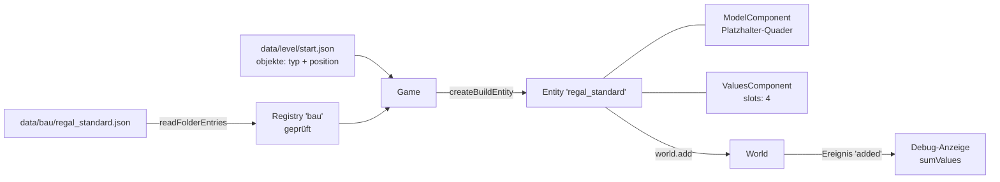

### Entities und Komponenten

```ts
const regal = new Entity('regal_standard');
regal.add(new ModelComponent(def.platzhalter));
regal.add(new ValuesComponent(def.werte));
world.add(regal);                     // ruft onAttach() aller Komponenten

regal.get(ValuesComponent)?.werte;    // Fähigkeit abfragen
for (const [e, v] of world.query(ValuesComponent)) { /* … */ }
```

Eine Komponente erbt von `Component` und nutzt nur, was sie braucht: `onAttach()`, `update(dt)`, `onDetach()`.

### Interaktion

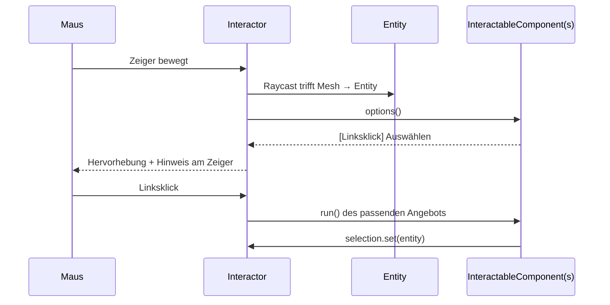

Eine neue Interaktion ist eine neue Komponente:

```ts
class EinraeumenComponent extends InteractableComponent {
  override readonly kontext = 'regal';
  options(by: Interactor) {
    return [{ aktion: 'auswaehlen', text: 'einraeumen', run: () => { /* … */ } }];
  }
}
```

Komponenten, die `describe()` haben, liefern automatisch Zeilen fürs Info-Fenster.

### Spielzustand und HUD

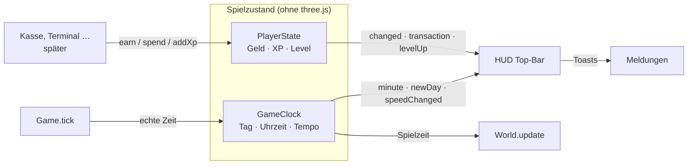

### Einkauf

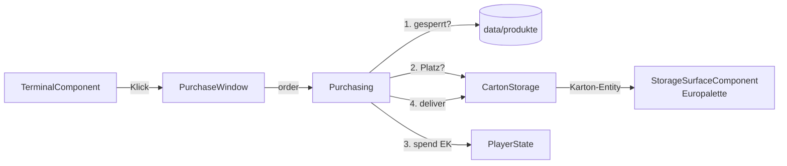

Ein Bauelement wird zur Lagerfläche mit `"ablage": { "ebenen": 2 }`; die Plätze ergeben sich aus Grundfläche und Kartonmaß (`data/lager/standard.json`).

### Bauen, Einräumen, Personal

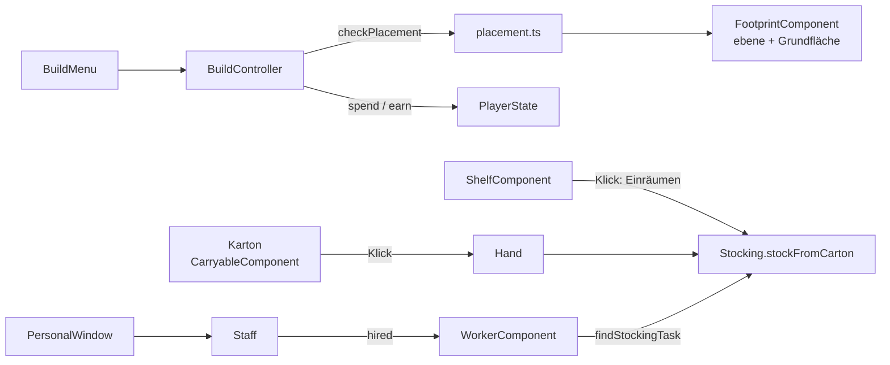

Jedes Bauelement hat eine **Ebene** (`boden`, `wand`, `anbau`, `objekt`, `decke`); sie bestimmt, was sich gegenseitig im Weg ist. Ein Regal bekommt `"regal": { "ebenen": [Bodenhöhen], "kapazitaet": 24, "kuehlung": false }`. Spieler und Personal benutzen dieselbe Einräum-Funktion.

### Kunden

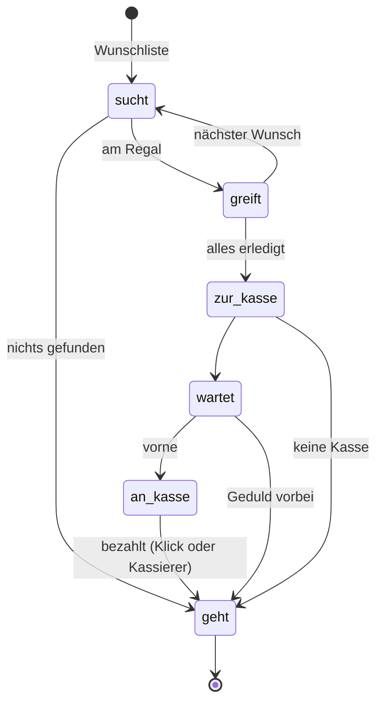

`StoreLoop` (src/core) verbindet Kundenzustrom (`CustomerSpawner`), Wege (`NavGrid`), Kassen (`CheckoutComponent`) und Kennzahlen (`StoreStats`). Die Oberfläche hängt sich nur an die Ereignisse.

### Voxel-Stil

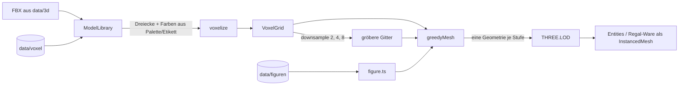

Die Umrechnung steckt nur in `ModelLibrary` und `src/voxel/`; Spiellogik und Komponenten merken davon nichts. Später können fertige Voxel-Modelle (z. B. aus MagicaVoxel) denselben Weg ab `VoxelGrid` nehmen.

`data/voxel/standard.json`:

```json
{ "aktiv": true, "kantenlaenge": 0.025,
  "stufen": [ { "ab": 0, "faktor": 1 }, { "ab": 16, "faktor": 2 } ],
  "regeln": [ { "pfad": "3d/Produkte/", "kantenlaenge": 0.004,
                "stufen": [ { "ab": 0, "faktor": 1 }, { "ab": 3, "faktor": 2 }, { "ab": 7, "faktor": 4 }, { "ab": 14, "faktor": 8 } ] } ] }
```

`stufen`: ab diesem Kameraabstand (m) werden faktor × faktor × faktor Würfel zu einem zusammengefasst (häufigste Farbe).

### Modelle aus dem Editor (data/modelle)

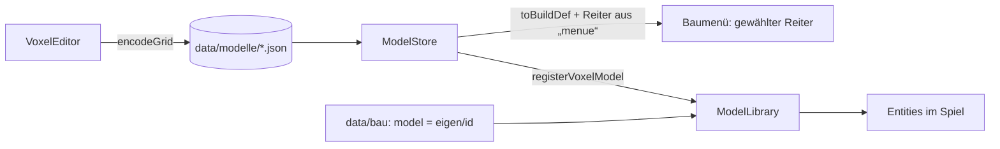

```json
{ "id": "eigen_rotes_regal", "name": "Rotes Regal", "typ": "regal", "menue": "einrichtung", "preis": 150, "ebene": "objekt",
  "kantenlaenge": 0.025, "groesse": [20, 72, 80], "palette": ["#c0573e", "#393939"],
  "voxel": "79*1,1*2,5600*1,…", "regal": { "kapazitaet": 20, "kuehlung": false }, "vorschau": "data:image/png;base64,…" }
```

- `typ`: `deko` oder `regal` = eigenes Bauteil im Baumenü, `modell` = nur das Modell (ein Bauteil in `data/bau` verweist darauf)
- `menue`: Reiter im Baumenü (`id` aus `data/baumenue/standard.json`). Fehlt es, gilt Einrichtung für Regale und Deko für alles andere. Der Reiter legt Kategorie und Bau-Ebene fest
- `voxel` zählt alle Zellen (x außen, dann y, dann z innen) als `Anzahl*Farbe` auf; Farbe 0 = leer, sonst Nummer in `palette` (ab 1)
- Neue ids aus dem Editor beginnen mit `modell_` (aus dem Namen gebildet)

### Datenformate

Produkt (`data/produkte/<id>.json`, Dateiname = id):

```json
{ "id": "cola_0_5l", "name": "Cola 0,5 L", "kategorie": "getraenke",
  "ek": 0.6, "vk": 1.19, "gebinde": 12, "preisOffen": true, "frisch": false, "freischaltLevel": 1,
  "model": "3d/Produkte/06_Getraenke/SM_Cola_0_5L.fbx", "icon": "3d/Icons_Produkte/T_Icon_Cola_0_5L.png",
  "groesse": [0.06, 0.189, 0.06] }
```

Bauelement (`data/bau/<id>.json`):

```json
{ "id": "kuehlregal_offen", "name": "Kühlregal Offen", "kategorie": "einrichtung", "ebene": "objekt", "kontext": "regal",
  "preis": 900, "freischaltLevel": 2, "werte": { "slots": 4, "strom": 0.9 },
  "model": "3d/Baubar/Einrichtung/SM_Build_Kuehlregal_Offen.fbx", "icon": "3d/Icons_Baubar/T_Build_Kuehlregal_Offen.png",
  "platzhalter": { "groesse": [0.6, 2, 2], "farbe": "#b9c0c6" } }
```

`funktionen` schaltet besondere Fähigkeiten ein (z. B. `"einkauf"`), `ablage` macht es zur Lagerfläche für Kartons. `kontext` macht das Element anklickbar (Werte aus `data/interaktion/kontexte.json`). `model` und `icon` verweisen auf Dateien unter `data/`. `platzhalter.groesse` sind die Maße des Modells (Breite, Höhe, Tiefe in Metern); der Quader erscheint, bis das Modell geladen ist. Jeder Schlüssel unter `werte` braucht einen Eintrag in `data/werte/standard.json`.

Lampe – zusätzliches Feld in `data/bau/<id>.json` (Position relativ zum Bauteil, Größe der Leuchtfläche, Stärke, Reichweite in m):

```json
"licht": { "position": [0, -1.45, 0], "groesse": [0.14, 0.05, 0.14], "farbe": "#ffd9a0", "staerke": 5, "reichweite": 6 }
```

Logistik (`data/logistik/standard.json`): `liefertermine`, `lieferkosten`, `express`, `wartezeitMinuten`, `fahrerAbladenProKarton`, `xpProKartonAbladen`, `lkw` (Modell, Größe, Ladefläche, Tempo). Ladetore sind Wandmodule mit `"funktionen": ["rampe"]` (Außenseite +X = Andockseite). Wagenboxen haben `"wagenbox": { "anzahl": 6 }`; das Verhalten der Kunden mit Wagen steht in `data/kunden/standard.json` → `einkaufswagen`.

Regeln, die überall gelten:

- **Logik in Code, Werte in Daten.** Zahlen und Inhalte stehen in `data/`, nicht im Code.
- **Kataloge lesen Ordner automatisch** (`readFolder('produkte')`), nichts wird von Hand gepflegt.
- **Neue Features ergänzen, statt Bestehendes umzuschreiben.**

## Nächste Meilensteine

1. ~~Grundgerüst mit Management-Kamera~~
2. ~~Entity-/Komponenten-System und Daten-Registry~~
3. ~~Interaktion: Objekte unter der Maus erkennen, hervorheben, anklicken; Kontext-Hinweise~~
4. ~~Stats und HUD (Geld, Level, Zeit) mit Events~~
5. ~~Einkaufsterminal und Produkte~~
6. ~~Regale und Einräumen~~ (Slots per Anker-Klick folgen später)
7. ~~Bausystem: Vorschau, Katalog, Bauen, Abreißen, Verschieben~~ – plus Personal
8. ~~Speichern/Laden mit 3 Slots, Haupt- und Pausemenü~~
9. ~~Kunden-KI: Spawner, Zustände, Wege, Kassen-Warteschlange~~
10. ~~Preise und Bilanz, Ausbau mit Grundstücken, Versorgung, Rohstoffe und Maschinen~~
11. ~~Voxel-Editor als Entwicklerwerkzeug~~
12. ~~Lager und Logistik: LKW, Ladetor, Lagerist, Umlagern~~
13. ~~Licht: Tag und Nacht, leuchtende Lampen~~
14. Danach: Animationen im Editor, mehrstufige Produktion, Standorte und Lieferketten
