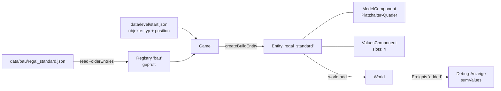
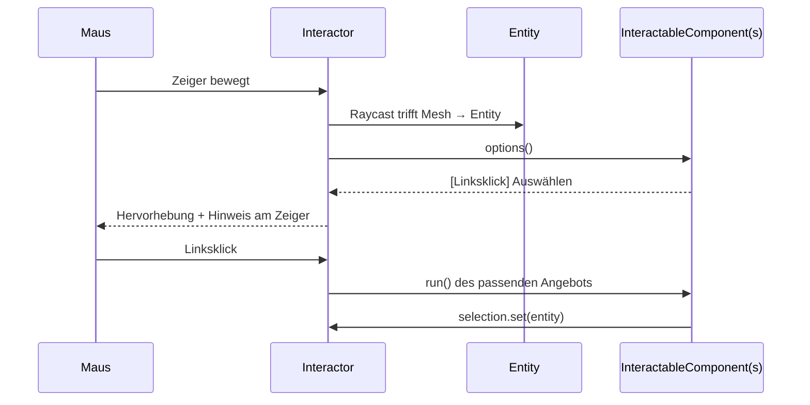
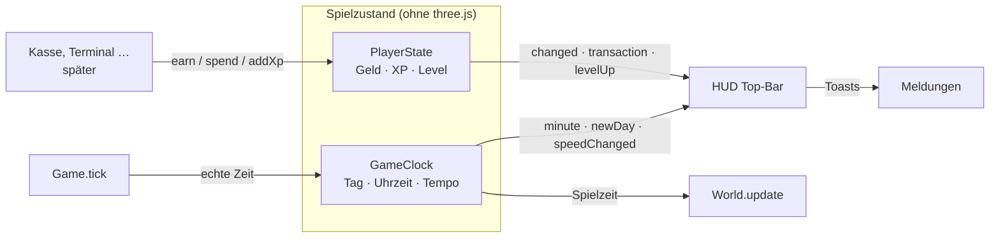
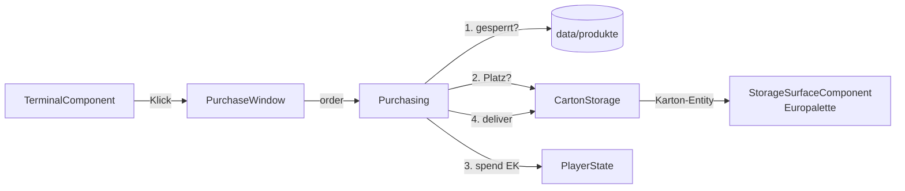
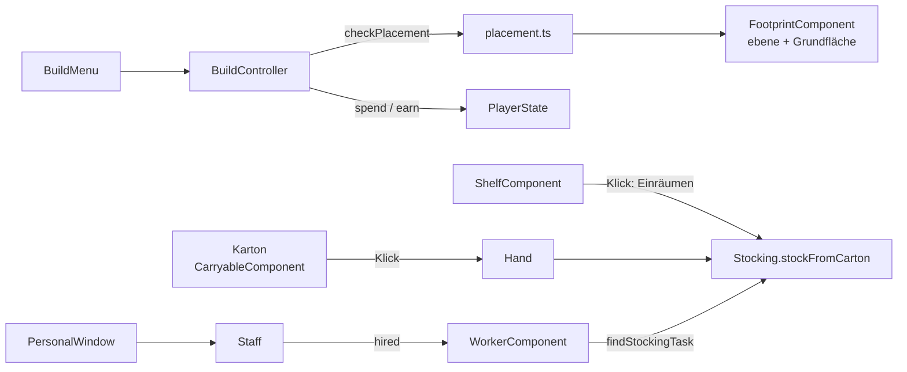
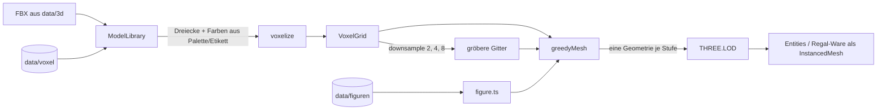

# UrbanEvolution

Wirtschaftssimulation im Browser mit Three.js und TypeScript. Du baust einen eigenen Supermarkt auf und führst ihn, später wächst daraus eine ganze Wertschöpfungskette: Rohstoffe, Produktion, Lager, Verkauf.

Das Spiel wird von **schräg oben** in einer **Management-Ansicht** gespielt, nicht in der Ego-Perspektive.

## Stand

**Meilenstein 1 – Grundgerüst** ✅

- Vite + TypeScript, Szene mit Himmel, Sonne und Schatten
- Testgelände aus `data/level/testgelaende.json`
- Management-Kamera: schwenken, drehen, zoomen, bleibt innerhalb des Geländes
- Feld unter der Maus wird markiert und oben angezeigt
- Tastenbelegung aus Daten, umbelegbar; die Hinweise unten lesen die aktuelle Belegung

**Meilenstein 2 – Entities, Komponenten und Daten-Registry** ✅

- Entity-/Komponenten-System (`src/ecs/`): Entities tragen Komponenten, die `World` verwaltet sie und meldet Änderungen über Ereignisse
- Inhalte werden beim Start aus `data/` geladen und geprüft (`src/content/`). Fehler nennen Datei und Feld.
- Regale, Kühlregal und Kasse im Testgelände sind Entities aus dem Bau-Katalog
- Debug-Anzeige (`F3`): geladene Daten, Objekte in der Welt und die **Summe der Bauteil-Werte**
- Automatische Tests mit Vitest

**Meilenstein 3 – Interaktion** ✅

- Objekte unter dem Mauszeiger werden erkannt und hervorgehoben (`src/interaction/Interactor.ts`)
- Gemeinsame Schnittstelle `InteractableComponent`: Jede Komponente bietet selbst an, was man mit ihr tun kann. Eine Entity kann mehrere solcher Komponenten tragen.
- Kontext unter dem Zeiger (`getContext()`, z. B. `regal`, `kasse`, `nichts`) und Hinweis am Zeiger wie „[Linksklick] Auswählen“, die Taste kommt live aus der Belegung
- Auswahl per Klick, Info-Fenster mit Zeilen aus den Komponenten, Abwählen per Klick ins Leere oder `Esc`

**Meilenstein 4 – Stats und HUD** ✅

- `PlayerState` (`src/state/`): Geld, XP und Level, getrennt von jeder Darstellung (Koop-Vorbereitung). Ausgaben, die das Konto übersteigen, werden abgelehnt; Beträge werden auf Cent gerundet.
- `GameClock`: Tag, Uhrzeit, Pause und drei Tempostufen. Die Simulation läuft im Spieltempo, die Kamera in Echtzeit.
- Top-Bar mit Kontostand (inklusive kurzer +/− Anzeige), Level mit XP-Balken, Wochentag/Tag/Uhrzeit und Tempo-Knöpfen
- Alles wird über Ereignisse aktualisiert (`changed`, `transaction`, `levelUp`, `minute`, `newDay`, `speedChanged`), nicht jeden Frame
- Meldungen (Toasts) für Level-Aufstieg und neuen Tag
- Debug-Anzeige mit Testknöpfen für Geld und XP

**Blender-Modelle** ✅

- 61 Bauelemente und 150 Produkte aus `data/3d/` (FBX aus Blender, Icons, Export-Listen)
- `npm run import:3d` erzeugt daraus `data/bau/*.json` und `data/produkte/*.json`
- `ModelLibrary` lädt die FBX-Dateien, teilt Geometrie zwischen Exemplaren und gibt allen Modellen **ein** gemeinsames Material mit der Palettentextur `2026 Palette.png`
- Produkte bekommen zusätzlich ihr Etikett aus `Produkt_Etiketten.png` (zweiter UV-Satz `UV_Icons`, über die Palettenfarbe gelegt)
- Das Testgelände ist aus den Modulen gebaut: Laden 14 × 10 m mit Schaufensterfront, Schiebetür, Ladenschild, Markisen, Kassen, Regalen, Kühlmöbeln, Obststand, Einkaufswagen, Gehweg und Lagerhof hinter dem Rolltor
- **Musterschau:** alle Bauteile und alle 150 Produkte – Adresse mit `#musterschau` öffnen

Noch offen: **Produktpreise** sind Startwerte je Kategorie (`"preisOffen": true`), bis die echte Preisliste da ist.

**Meilenstein 5 – Einkaufsterminal und Produkte** ✅

- Einkaufsterminal im Lagerhof (`data/bau/einkaufsterminal.json`, Funktion `"einkauf"`): Klick öffnet den Großhandel
- Großhandel-Fenster: alle Produkte aus `data/produkte`, nach Warenkategorie in Tabs, mit Icon, EK, VK und Kartonpreis; gesperrte Produkte zeigen „ab Level …“
- Gekauft wird kartonweise (`"gebinde"` = Stück pro Karton). Bezahlt wird der EK sofort, die Ware steht als **Kartons auf den Europaletten** (je 12 Plätze)
- Geprüft wird vor dem Bezahlen: Auswahl leer, Produkt gesperrt, **zu wenig Lagerplatz**, zu wenig Geld – ein Fehler ändert nichts
- Kartons sind Entities: anklicken zeigt Produkt, Stückzahl, Einkaufs- und Verkaufswert; oben drauf steht eine Packung des Produkts
- Pro Taste gilt nur das wichtigste Angebot (`prioritaet`): Klick aufs Terminal öffnet den Einkauf statt es auszuwählen

**Kleiner Start-Laden, Baumenü, Einräumen und Personal** ✅

- Das Spiel startet jetzt im **leeren Laden 8 × 6 m** (`data/level/start.json`): Fliesen, Wände, Schaufensterfront, Einkaufsterminal und zwei Europaletten – sonst nichts. Testgelände und Musterschau gibt es weiter über `#testgelaende` und `#musterschau`
- **Baumenü** (`B` oder Knopf „Bauen“): Kategorien aus `data/baumenue/standard.json` als Tabs, Katalog mit Icon und Preis. Vorschau folgt der Maus (grün = frei, rot = geht nicht), `R` dreht, Linksklick baut, `Esc` bricht ab
- Bauregeln (`src/building/placement.ts`): Objekte brauchen Boden, dürfen sich nicht mit Objekten oder Wänden überschneiden, kosten Geld und müssen freigeschaltet sein. **Abreißen** gibt die Hälfte zurück, **Verschieben** ist kostenlos; beides nur, wenn keine Kartons bzw. keine Ware darauf liegen
- **Einräumen von Hand:** Karton anklicken → er ist „in der Hand“ (Anzeige unten) → Regal anklicken → Ware wandert in die Fächer und ist im Regal zu sehen. Gekühlte Ware passt nur ins Kühlregal. Handarbeit bringt XP (`data/arbeit/standard.json`)
- **Personal** (`P` oder Knopf „Personal“): jeden Tag neue Bewerbungen, einstellen, entlassen. Auffüller holen selbstständig Kartons von den Paletten und räumen sie ein. Der Lohn wird zu Beginn jedes Tages fällig – reicht das Geld nicht, kündigt die Person. Werte in `data/personal/`

Noch vereinfacht: Das Personal läuft in gerader Linie (Wegfindung kommt mit der Kunden-KI).

**Voxel-Stil** ✅

- Alle Blender-Modelle erscheinen als Würfel: beim ersten Laden einmal umgerechnet, Farben aus Palette und Etikett. Gebäude und Einrichtung mit 2,5 cm, Produkte mit 4 mm – Flaschen, Deckel und Etiketten bleiben erkennbar
- **Schnell trotz Details:** gleichfarbige Würfelflächen werden zu großen Rechtecken zusammengefasst (Greedy Meshing), alle Exemplare teilen sich eine Geometrie, gleiche Ware im Regal ist ein einziger Zeichenaufruf (InstancedMesh), und aus der Ferne werden automatisch gröbere Detailstufen gezeigt
- Figuren für Personal (und bald Kunden) sind aus Würfeln gebaut: Haut, Frisur, Kleidung aus `data/figuren/standard.json`; beim Personal hat das Oberteil die Farbe der Rolle
- Alles einstellbar in `data/voxel/standard.json`; `?stil=lowpoly` in der Adresse zeigt die Original-Modelle (z. B. `…/?stil=lowpoly#testgelaende`)


## Starten

Du brauchst [Node.js](https://nodejs.org) (Version 20 oder neuer).

```bash
npm install      # einmalig: Abhängigkeiten holen
npm run dev      # Entwicklungsserver starten, Adresse steht dann im Terminal
```

Weitere Befehle:

| Befehl | Was passiert |
|---|---|
| `npm test` | automatische Tests (Entities, Daten, Modelle, Voxel) |
| `npm run import:3d` | Blender-Exporte aus `data/3d` in die Spieldaten übernehmen |
| `npm run check` | nur Typprüfung |
| `npm run build` | Typprüfung und fertiger Build in `dist/` |
| `npm run preview` | den Build lokal ansehen |
| `npm run build:artifact` | Build für claude.ai-Artifacts in `dist-artifact/` (Modelle als JS eingebettet, weil Artifacts keine .fbx-Dateien ausliefern) |

Im Entwicklungsmodus ist das Spiel in der Browser-Konsole als `urbanEvolution` erreichbar, z. B. `urbanEvolution.view.zoom(-2)`.

## Steuerung

| Aktion | Standard |
|---|---|
| Kamera schwenken | `W` `A` `S` `D` oder Pfeiltasten, mittlere Maustaste ziehen |
| Kamera drehen | `Q` / `E`, rechte Maustaste ziehen |
| Zoomen | Mausrad |
| Zeit anhalten / weiter | `Leertaste` |
| Tempo 1 / 2 / 3 | `1` `2` `3` |
| Objekt auswählen | Linksklick |
| Auswahl aufheben | Klick ins Leere oder `Esc` |
| Baumenü auf/zu | `B` |
| Personal auf/zu | `P` |
| Bauvorschau drehen | `R` |
| Karton aufnehmen / ins Regal | Linksklick auf Karton, dann auf Regal |
| Abbrechen, Fenster schließen, Karton abstellen | `Esc` (schließt immer nur das Oberste) |
| Debug-Anzeige an/aus | `F3` |

Die Belegung steht in `data/eingabe/standard.json`.

## 3D-Modelle

Die Modelle kommen als FBX aus Blender nach `data/3d/`:

```
data/3d/
  Baubar/<Kategorie>/SM_Build_*.fbx      Bauelemente
  Baubar/_export_liste.csv               Name, Kategorie, Maße in cm, Datei
  Produkte/<Nr>_<Kategorie>/SM_*.fbx     Produkte
  Produkte/_export_liste.csv
  Icons_Baubar/T_Build_*.png             Vorschaubilder fürs UI
  Icons_Produkte/T_Icon_*.png
  2026 Palette.png                       Farbpalette (alle Modelle, UV-Satz "UV_Palette")
  Produkt_Etiketten.png                  Etiketten-Atlas (Produkte, UV-Satz "UV_Icons")
```

Nach neuen oder geänderten Exporten:

```bash
npm run import:3d
```

Das Skript legt für jedes Modell eine JSON-Datei an (`data/bau/<id>.json`, `data/produkte/<id>.json`). Bei bestehenden Dateien aktualisiert es nur `model`, `icon` und die Maße – Preise, Kontext und Werte, die man von Hand pflegt, bleiben erhalten. Startwerte für neue Einträge und deutsche Namen stehen in `scripts/import-3d.config.json`.

Konventionen der Modelle (aus dem Export gemessen):

| | |
|---|---|
| Einheit | Meter, Y nach oben, Ursprung unten in der Mitte |
| Raster | Wände, Fenster, Türen 2 m breit, 4 m hoch; Bodenplatten 2 × 2 m |
| Wände | laufen in der Länge entlang Z; die **Außenseite ist +X** |
| Anbauteile | Markise, Ladenschild, Außenlampe, Eingangsstufe: gleiche Position und Drehung wie das Wandmodul |
| Drehung einer Wand | Außenseite +X: 0°, −X: 180°, +Z: −90°, −Z: 90° |
| Leuchten, Lichtschienen | hängen vom Ursprung nach unten → auf Deckenhöhe (4 m) setzen |
| Bodenhöhe | Fliesen 5 cm, Gehweg 14 cm – Objekte darauf entsprechend höher setzen |
| Materialien | `M_Glass` wird Glas, alles andere die Palette; Produkte (`M_Produkte`) zusätzlich mit Etikett |

## Aufbau

```
data/                   Werte und Inhalte (JSON), werden automatisch eingelesen
  bau/                  Bauelemente, eine Datei pro Element
  produkte/             Produkte, eine Datei pro Produkt
  sortiment/            Warenkategorien
  werte/                Namen und Einheiten der Bauteil-Werte (Strom, Regalplätze …)
  lager/                Kartonmaße und -farbe
  interaktion/          Kontexte (Regal, Kasse …)
  texte/                Anzeigetexte mit Platzhaltern, z. B. "Level {level} erreicht"
  spieler/              Startwerte (Geld, XP) und XP-Grenzen der Level
  zeit/                 Startzeit, Minuten pro Sekunde, Tempostufen, Wochentage
  eingabe/              Tastenbelegung (Aktion → Tasten)
  kamera/               Kamerawerte
  level/                Level-Dateien: Kulisse und platzierte Objekte ("typ" = Bauelement, "produkt" = Produkt, "wiederholen" für Reihen)
  3d/                   Blender-Exporte (FBX, Icons, Export-Listen)
src/
  main.ts               Einstieg: Spiel erzeugen und starten
  core/Game.ts          Renderer, Szene, Spielschleife – verbindet die Systeme
  core/Data.ts          liest Dateien und ganze Ordner aus data/
  core/Emitter.ts       Ereignisse senden und abonnieren
  interaction/          Interactor, InteractableComponent, Auswahl, Hervorhebung
  state/                Spielzustand ohne Darstellung: PlayerState, GameClock
  economy/              Purchasing (Einkauf beim Großhandel)
  ecs/                  Entity, Component, World
  components/           wiederverwendbare Komponenten (Modell, Werte …)
  content/              Datenformate, Prüfung, Registry, Content
  factory/              baut Entities aus Datendefinitionen (Bauelemente, Produkte)
  assets/               ModelLibrary (lädt FBX, Palette, Glas), LabelMaterial (Etiketten)
  input/                InputMap (Aktionen statt fester Tasten), Pointer (Mauszeiger)
  camera/               Management-Kamera
  world/                Level-Kulisse, Feld unter der Maus, CartonStorage (Lager aus allen Ablageflächen)
  ui/                   HUD (Top-Bar), Toasts, Hinweis am Zeiger, Info-Fenster, Debug-Anzeige, UI-Kit (style.css)
scripts/                import-3d.mjs und seine Konfiguration
tests/                  automatische Tests
```

### Wie ein Objekt entsteht



### Entities und Komponenten

```ts
const regal = new Entity('regal_standard');
regal.add(new ModelComponent(def.platzhalter));
regal.add(new ValuesComponent(def.werte));
world.add(regal);                     // ruft onAttach() aller Komponenten

regal.get(ValuesComponent)?.werte;    // Fähigkeit abfragen
for (const [e, v] of world.query(ValuesComponent)) { /* … */ }
```

Eine Komponente erbt von `Component` und nutzt nur, was sie braucht: `onAttach()`, `update(dt)`, `onDetach()`.

### Interaktion



Eine neue Interaktion ist eine neue Komponente:

```ts
class EinraeumenComponent extends InteractableComponent {
  override readonly kontext = 'regal';
  options(by: Interactor) {
    return [{ aktion: 'auswaehlen', text: 'einraeumen', run: () => { /* … */ } }];
  }
}
```

Komponenten, die `describe()` haben, liefern automatisch Zeilen fürs Info-Fenster.

### Spielzustand und HUD



### Einkauf



Ein Bauelement wird zur Lagerfläche mit `"ablage": { "ebenen": 2 }`; die Plätze ergeben sich aus Grundfläche und Kartonmaß (`data/lager/standard.json`).

### Bauen, Einräumen, Personal



Jedes Bauelement hat eine **Ebene** (`boden`, `wand`, `anbau`, `objekt`, `decke`); sie bestimmt, was sich gegenseitig im Weg ist. Ein Regal bekommt `"regal": { "ebenen": [Bodenhöhen], "kapazitaet": 24, "kuehlung": false }`. Spieler und Personal benutzen dieselbe Einräum-Funktion.

### Voxel-Stil



Die Umrechnung steckt nur in `ModelLibrary` und `src/voxel/`; Spiellogik und Komponenten merken davon nichts. Später können fertige Voxel-Modelle (z. B. aus MagicaVoxel) denselben Weg ab `VoxelGrid` nehmen.

`data/voxel/standard.json`:

```json
{ "aktiv": true, "kantenlaenge": 0.025,
  "stufen": [ { "ab": 0, "faktor": 1 }, { "ab": 16, "faktor": 2 } ],
  "regeln": [ { "pfad": "3d/Produkte/", "kantenlaenge": 0.004,
                "stufen": [ { "ab": 0, "faktor": 1 }, { "ab": 3, "faktor": 2 }, { "ab": 7, "faktor": 4 }, { "ab": 14, "faktor": 8 } ] } ] }
```

`stufen`: ab diesem Kameraabstand (m) werden faktor × faktor × faktor Würfel zu einem zusammengefasst (häufigste Farbe).

### Datenformate

Produkt (`data/produkte/<id>.json`, Dateiname = id):

```json
{ "id": "cola_0_5l", "name": "Cola 0,5 L", "kategorie": "getraenke",
  "ek": 0.6, "vk": 1.19, "gebinde": 12, "preisOffen": true, "frisch": false, "freischaltLevel": 1,
  "model": "3d/Produkte/06_Getraenke/SM_Cola_0_5L.fbx", "icon": "3d/Icons_Produkte/T_Icon_Cola_0_5L.png",
  "groesse": [0.06, 0.189, 0.06] }
```

Bauelement (`data/bau/<id>.json`):

```json
{ "id": "kuehlregal_offen", "name": "Kühlregal Offen", "kategorie": "einrichtung", "ebene": "objekt", "kontext": "regal",
  "preis": 900, "freischaltLevel": 2, "werte": { "slots": 4, "strom": 0.9 },
  "model": "3d/Baubar/Einrichtung/SM_Build_Kuehlregal_Offen.fbx", "icon": "3d/Icons_Baubar/T_Build_Kuehlregal_Offen.png",
  "platzhalter": { "groesse": [0.6, 2, 2], "farbe": "#b9c0c6" } }
```

`funktionen` schaltet besondere Fähigkeiten ein (z. B. `"einkauf"`), `ablage` macht es zur Lagerfläche für Kartons. `kontext` macht das Element anklickbar (Werte aus `data/interaktion/kontexte.json`). `model` und `icon` verweisen auf Dateien unter `data/`. `platzhalter.groesse` sind die Maße des Modells (Breite, Höhe, Tiefe in Metern); der Quader erscheint, bis das Modell geladen ist. Jeder Schlüssel unter `werte` braucht einen Eintrag in `data/werte/standard.json`.

Regeln, die überall gelten:

- **Logik in Code, Werte in Daten.** Zahlen und Inhalte stehen in `data/`, nicht im Code.
- **Kataloge lesen Ordner automatisch** (`readFolder('produkte')`), nichts wird von Hand gepflegt.
- **Neue Features ergänzen, statt Bestehendes umzuschreiben.**

## Nächste Meilensteine

1. ~~Grundgerüst mit Management-Kamera~~
2. ~~Entity-/Komponenten-System und Daten-Registry~~
3. ~~Interaktion: Objekte unter der Maus erkennen, hervorheben, anklicken; Kontext-Hinweise~~
4. ~~Stats und HUD (Geld, Level, Zeit) mit Events~~
5. ~~Einkaufsterminal und Produkte~~
6. ~~Regale und Einräumen~~ (Slots per Anker-Klick folgen später)
7. ~~Bausystem: Vorschau, Katalog, Bauen, Abreißen, Verschieben~~ – plus Personal
8. Speichern/Laden mit 3 Slots, Haupt- und Pausemenü
9. Kunden-KI: Spawner, Zustände, Wege, Kassen-Warteschlange
10. Danach: Versorgung, erweitertes Bausystem, Fabrik, Lager, Rohstoffe
