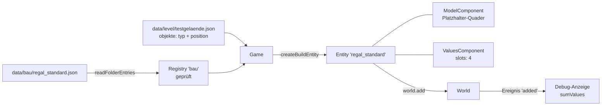
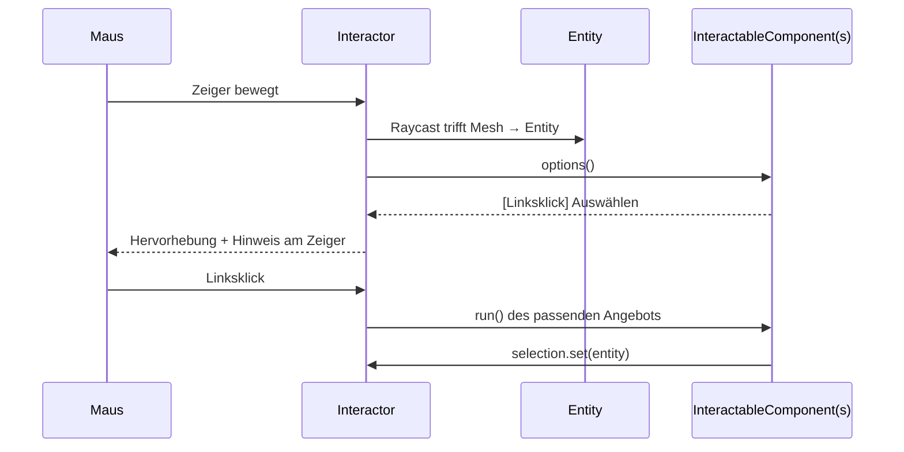
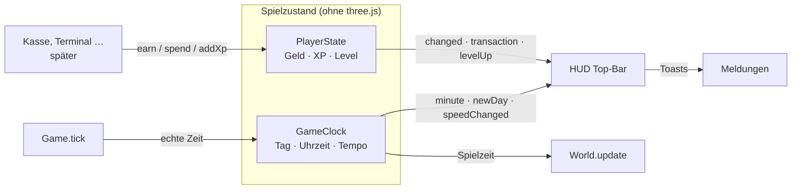

# UrbanEvolution

Wirtschaftssimulation im Browser mit Three.js und TypeScript. Du baust einen eigenen Supermarkt auf und führst ihn, später wächst daraus eine ganze Wertschöpfungskette: Rohstoffe, Produktion, Lager, Verkauf.

Das Spiel wird von **schräg oben** in einer **Management-Ansicht** gespielt, nicht in der Ego-Perspektive.

## Stand

**Meilenstein 1 – Grundgerüst** ✅

- Vite + TypeScript, Szene mit Himmel, Sonne und Schatten
- Testgelände aus `data/level/testgelaende.json`
- Management-Kamera: schwenken, drehen, zoomen, bleibt innerhalb des Geländes
- Feld unter der Maus wird markiert und oben angezeigt
- Tastenbelegung aus Daten, umbelegbar; die Hinweise unten lesen die aktuelle Belegung

**Meilenstein 2 – Entities, Komponenten und Daten-Registry** ✅

- Entity-/Komponenten-System (`src/ecs/`): Entities tragen Komponenten, die `World` verwaltet sie und meldet Änderungen über Ereignisse
- Inhalte werden beim Start aus `data/` geladen und geprüft (`src/content/`). Fehler nennen Datei und Feld.
- Regale, Kühlregal und Kasse im Testgelände sind Entities aus dem Bau-Katalog
- Debug-Anzeige (`F3`): geladene Daten, Objekte in der Welt und die **Summe der Bauteil-Werte**
- Automatische Tests mit Vitest

**Meilenstein 3 – Interaktion** ✅

- Objekte unter dem Mauszeiger werden erkannt und hervorgehoben (`src/interaction/Interactor.ts`)
- Gemeinsame Schnittstelle `InteractableComponent`: Jede Komponente bietet selbst an, was man mit ihr tun kann. Eine Entity kann mehrere solcher Komponenten tragen.
- Kontext unter dem Zeiger (`getContext()`, z. B. `regal`, `kasse`, `nichts`) und Hinweis am Zeiger wie „[Linksklick] Auswählen“, die Taste kommt live aus der Belegung
- Auswahl per Klick, Info-Fenster mit Zeilen aus den Komponenten, Abwählen per Klick ins Leere oder `Esc`

**Meilenstein 4 – Stats und HUD** ✅

- `PlayerState` (`src/state/`): Geld, XP und Level, getrennt von jeder Darstellung (Koop-Vorbereitung). Ausgaben, die das Konto übersteigen, werden abgelehnt; Beträge werden auf Cent gerundet.
- `GameClock`: Tag, Uhrzeit, Pause und drei Tempostufen. Die Simulation läuft im Spieltempo, die Kamera in Echtzeit.
- Top-Bar mit Kontostand (inklusive kurzer +/− Anzeige), Level mit XP-Balken, Wochentag/Tag/Uhrzeit und Tempo-Knöpfen
- Alles wird über Ereignisse aktualisiert (`changed`, `transaction`, `levelUp`, `minute`, `newDay`, `speedChanged`), nicht jeden Frame
- Meldungen (Toasts) für Level-Aufstieg und neuen Tag
- Debug-Anzeige mit Testknöpfen für Geld und XP

Die Produkte in `data/produkte/` sind **Beispiele**, bis die CSV mit den 50 Produkten eingespielt ist.

## Starten

Du brauchst [Node.js](https://nodejs.org) (Version 20 oder neuer).

```bash
npm install      # einmalig: Abhängigkeiten holen
npm run dev      # Entwicklungsserver starten, Adresse steht dann im Terminal
```

Weitere Befehle:

| Befehl | Was passiert |
|---|---|
| `npm test` | automatische Tests (Entities, Daten) |
| `npm run check` | nur Typprüfung |
| `npm run build` | Typprüfung und fertiger Build in `dist/` |
| `npm run preview` | den Build lokal ansehen |

Im Entwicklungsmodus ist das Spiel in der Browser-Konsole als `urbanEvolution` erreichbar, z. B. `urbanEvolution.view.zoom(-2)`.

## Steuerung

| Aktion | Standard |
|---|---|
| Kamera schwenken | `W` `A` `S` `D` oder Pfeiltasten, mittlere Maustaste ziehen |
| Kamera drehen | `Q` / `E`, rechte Maustaste ziehen |
| Zoomen | Mausrad |
| Zeit anhalten / weiter | `Leertaste` |
| Tempo 1 / 2 / 3 | `1` `2` `3` |
| Objekt auswählen | Linksklick |
| Auswahl aufheben | Klick ins Leere oder `Esc` |
| Debug-Anzeige an/aus | `F3` |

Die Belegung steht in `data/eingabe/standard.json`.

## Aufbau

```
data/                   Werte und Inhalte (JSON), werden automatisch eingelesen
  bau/                  Bauelemente, eine Datei pro Element
  produkte/             Produkte, eine Datei pro Produkt
  sortiment/            Warenkategorien
  werte/                Namen und Einheiten der Bauteil-Werte (Strom, Regalplätze …)
  interaktion/          Kontexte (Regal, Kasse …)
  texte/                Anzeigetexte mit Platzhaltern, z. B. "Level {level} erreicht"
  spieler/              Startwerte (Geld, XP) und XP-Grenzen der Level
  zeit/                 Startzeit, Minuten pro Sekunde, Tempostufen, Wochentage
  eingabe/              Tastenbelegung (Aktion → Tasten)
  kamera/               Kamerawerte
  level/                Level-Dateien: feste Kulisse und platzierte Objekte
src/
  main.ts               Einstieg: Spiel erzeugen und starten
  core/Game.ts          Renderer, Szene, Spielschleife – verbindet die Systeme
  core/Data.ts          liest Dateien und ganze Ordner aus data/
  core/Emitter.ts       Ereignisse senden und abonnieren
  interaction/          Interactor, InteractableComponent, Auswahl, Hervorhebung
  state/                Spielzustand ohne Darstellung: PlayerState, GameClock
  ecs/                  Entity, Component, World
  components/           wiederverwendbare Komponenten (Modell, Werte …)
  content/              Datenformate, Prüfung, Registry, Content
  factory/              baut Entities aus Datendefinitionen
  input/                InputMap (Aktionen statt fester Tasten), Pointer (Mauszeiger)
  camera/               Management-Kamera
  world/                Level-Kulisse, Feld unter der Maus
  ui/                   HUD (Top-Bar), Toasts, Hinweis am Zeiger, Info-Fenster, Debug-Anzeige, UI-Kit (style.css)
tests/                  automatische Tests
```

### Wie ein Objekt entsteht



### Entities und Komponenten

```ts
const regal = new Entity('regal_standard');
regal.add(new ModelComponent(def.platzhalter));
regal.add(new ValuesComponent(def.werte));
world.add(regal);                     // ruft onAttach() aller Komponenten

regal.get(ValuesComponent)?.werte;    // Fähigkeit abfragen
for (const [e, v] of world.query(ValuesComponent)) { /* … */ }
```

Eine Komponente erbt von `Component` und nutzt nur, was sie braucht: `onAttach()`, `update(dt)`, `onDetach()`.

### Interaktion



Eine neue Interaktion ist eine neue Komponente:

```ts
class EinraeumenComponent extends InteractableComponent {
  override readonly kontext = 'regal';
  options(by: Interactor) {
    return [{ aktion: 'auswaehlen', text: 'einraeumen', run: () => { /* … */ } }];
  }
}
```

Komponenten, die `describe()` haben, liefern automatisch Zeilen fürs Info-Fenster.

### Spielzustand und HUD



### Datenformate

Produkt (`data/produkte/<id>.json`, Dateiname = id):

```json
{ "id": "milch_1l", "name": "Milch 1 L", "kategorie": "molkerei_eier",
  "ek": 0.69, "vk": 1.09, "frisch": true, "freischaltLevel": 1 }
```

Bauelement (`data/bau/<id>.json`):

```json
{ "id": "kuehlregal", "name": "Kühlregal", "kategorie": "einrichtung", "kontext": "regal", "preis": 450, "freischaltLevel": 2,
  "platzhalter": { "groesse": [3, 2.1, 0.8], "farbe": "#cfe0e6" },
  "werte": { "slots": 3, "strom": 0.8 } }
```

`kontext` macht das Element anklickbar (Werte aus `data/interaktion/kontexte.json`). `model` und `icon` sind optional und werden genutzt, sobald es die Blender-Exporte gibt. Jeder Schlüssel unter `werte` braucht einen Eintrag in `data/werte/standard.json`.

Regeln, die überall gelten:

- **Logik in Code, Werte in Daten.** Zahlen und Inhalte stehen in `data/`, nicht im Code.
- **Kataloge lesen Ordner automatisch** (`readFolder('produkte')`), nichts wird von Hand gepflegt.
- **Neue Features ergänzen, statt Bestehendes umzuschreiben.**

## Nächste Meilensteine

1. ~~Grundgerüst mit Management-Kamera~~
2. ~~Entity-/Komponenten-System und Daten-Registry~~
3. ~~Interaktion: Objekte unter der Maus erkennen, hervorheben, anklicken; Kontext-Hinweise~~
4. ~~Stats und HUD (Geld, Level, Zeit) mit Events~~
5. Einkaufsterminal und Produkte
6. Regal-Slots inklusive Anlegen per Klick (Anker → A → B) und Einräumen
7. Bausystem: Vorschau, Katalog, Bauen, Abreißen, Verschieben
8. Speichern/Laden mit 3 Slots, Haupt- und Pausemenü
9. Kunden-KI: Spawner, Zustände, Wege, Kassen-Warteschlange
10. Danach: Versorgung, erweitertes Bausystem, Fabrik, Lager, Rohstoffe
