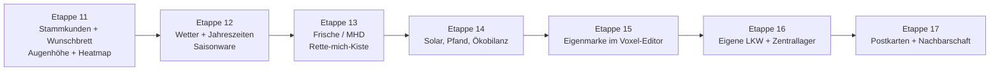

# Ideen und nächste Schritte

Was UrbanEvolution besonders machen kann: Ideen, die auf dem aufbauen, was schon da ist (Voxel-Look und Editor,
Wertschöpfungskette mit Maschinen, Strom/Wasser, Gelände, Kunden mit Gedanken, alles datengetrieben),
und die es in Supermarkt- und Aufbauspielen so kaum gibt. Bewertung: ★ = wie neu, ● = Aufwand (● klein … ●●● groß).

## Die besten Kandidaten

### 1. Stammkunden mit Gedächtnis – die Nachbarschaft erzählt Geschichten ★★★ ●●
Jeder Kunde ist eine feste Person aus der Nachbarschaft: Name, Aussehen, Lieblingsprodukte, Tagesablauf
(Frau Meier kommt jeden Morgen um 8 für Brötchen, der Student nachts für Energy-Drinks). Kunden merken sich,
was ihnen fehlte und was zu teuer war; dreimal kein Mozzarella → sie gehen zur Konkurrenz. Ihr Leben verändert sich:
Paare bekommen ein Baby (plötzlich Windeln gefragt), jemand wird Rentner (kommt vormittags).
- **Wunschbrett** im Laden: Kunden pinnen Zettel („Bitte glutenfreies Brot!“) – kleine Aufträge mit Belohnung (Treue, Ruf)
- Kundenkarte im Personenfenster: Vorlieben, letzte Besuche, Zufriedenheit
- Baut direkt auf den Gedankenblasen auf

### 2. Augenhöhe und Laufwege – echte Laden-Psychologie als Spiel ★★★ ●
Regale haben schon Böden in festen Höhen. Ware auf Augenhöhe verkauft sich besser, die Bückzone schlechter,
Quengelware an der Kasse wird spontan mitgenommen, Obst am Eingang hebt die Stimmung, Kühlung hinten zieht
Kunden durch den ganzen Laden. Dazu eine **Laufwege-Heatmap** (wo laufen Kunden, wo bleiben sie stehen) und
**Blickfang-Plätze** (Kopfenden der Regalreihen).
- Neu im Genre: Planogramm und Ladenlayout sind das eigentliche Rätsel, nicht nur „Regal voll machen“

### 3. Wetter und Jahreszeiten im Voxel-Stil ★★ ●●
Regen (Pfützen, Regenschirme bei Passanten, weniger Laufkundschaft, mehr Suppe), Hitzewelle (Eis und Wasser
ausverkauft), Herbstlaub fällt von den Straßenbäumen, im Winter liegt Voxel-Schnee auf Dach und Gelände,
Weihnachtsmarktstand vor dem Laden. Saisonware (Spargel, Lebkuchen, Grillgut) mit eigener Nachfragekurve.
- Das Voxel-Gelände ist dafür perfekt: Schnee ist einfach eine weiße Schicht obendrauf

### 4. Frische, Haltbarkeit und „Rette-mich“-Kiste ★★ ●●
Frischware hat ein Mindesthaltbarkeitsdatum. Abends klebt das Personal Rabattsticker drauf (Kunden stürzen sich
darauf), was übrig bleibt, geht an die Tafel (+Ruf) oder in die „Rette-mich“-Kiste. Mit dem Einkäufer zusammen
wird Bestellen zur Kunst: zu viel → Verlust, zu wenig → leere Regale.

### 5. Nachhaltiger Laden: Solar aufs Dach, Pfandautomat, Ökobilanz ★★ ●●
Die Versorgung (Strom/Wasser) gibt es schon, das Dach auch. Solarmodule aufs Dach bauen (sichtbar, wenn
herausgezoomt), Batteriespeicher für die Kühlung nachts, ein Pfandautomat, an dem Kunden Flaschen zurückgeben
(Laufkundschaft!), Regionalware vom eigenen Hof. Eine **Ökobilanz** neben der Bilanz – manche Kunden achten darauf.

### 6. Eigenmarke im Voxel-Editor ★★★ ●●
Der Voxel-Editor kann schon Modelle bauen. Damit gestaltet man eigene Produkte: Verpackung malen, Name,
Preis, Rezept aus eigenen Maschinen (Saftpresse, Backstation). Kunden bewerten die Eigenmarke (Preis, Frische,
Aussehen); gute Eigenmarken werden zum Kult und ziehen Kunden aus der ganzen Stadt.
- Kein anderes Ladenspiel lässt dich die Packung selbst in 3D bauen

### 7. Eigene LKW und Fahrten zum Zentrallager ★ ●●●
(schon angekündigt) Fuhrpark kaufen, Fahrer einstellen, auf einer kleinen Karte zu Großhändlern fahren
(Preise und Entfernungen unterschiedlich), Kühl-LKW für Tiefkühlware, Touren mit mehreren Stopps.
- **Festgelegt:** Eigene LKW werden **immer selbst abgeladen** (Lagerist, Staplerfahrer oder von Hand) – kein Fahrer, der gegen Gebühr ablädt. Im Zweifel bleiben sie eben länger an der Rampe stehen.

### 8. Nachbarschaft zum Teilen: Postkarten und Besuche ★★★ ●●
Foto-Modus mit Tilt-Shift macht aus dem Laden eine **Postkarte** (Bild + Spielstand). Andere öffnen die Postkarte
und laufen als Gast durch deinen Laden (nur ansehen) – oder stellen ihn als Nachbargeschäft in ihre Straße.
Dazu ein **Tagebuch**: jeden Abend ein Bild, am Ende ein Zeitraffer, wie aus dem kleinen Laden ein Markt wurde.

### Weitere kleine Ideen
- **Pausenraum und Laune** fürs Personal: wer Pausen bekommt, arbeitet schneller; Freundschaften im Team ★ ●
- **Café-Ecke** im Laden (Kaffeemaschine, Bänke): Kunden bleiben länger, kaufen mehr, Treffpunkt der Nachbarschaft ★ ●
- **Stadtfeste und Ereignisse**: Fußballabend (Chips, Bier), Schulanfang (Hefte), Stromausfall (Kühlung rettet, wer einen Generator hat) ★★ ●
- **Kinder an der Hand** der Eltern, die an der Quengelware zerren ★ ●
- **Lieferdienst per Lastenrad** für Stammkunden ★★ ●●

## Vorschlag für die Reihenfolge

Warum diese Reihenfolge: Etappe 11 macht aus den neuen Gedankenblasen echtes Spiel und kostet wenig. Wetter und
Jahreszeiten geben jedem Spieltag Abwechslung. Frische und Nachhaltigkeit vertiefen die Wirtschaft, bevor mit
Eigenmarke und eigenen LKW die großen Systeme kommen. Das Teilen kommt zuletzt, wenn es viel zu zeigen gibt.
